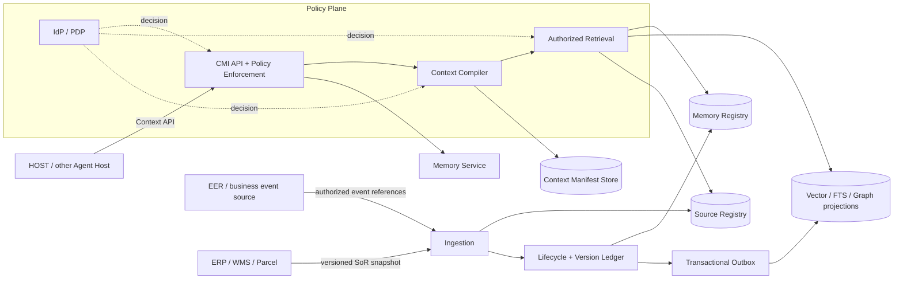
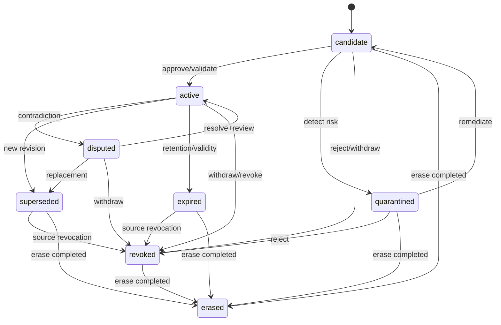

# IDP-CMI Core Specification V1.0

**IDP Context & Memory Infrastructure · 核心技术规格**  
**文档编号** CMI-SPEC-CORE-001 · **发布日期** 2026-10-15 · **状态** Draft for Architecture Review（技术评审草案）  
**基准** IDP-CMI Architecture RFC V1.0；IDP EER White Paper Master V2.0；IDP HOST 与 EER 独立性决策（2026-10-15）。

> **规范性声明**：本文件规定 IDP-CMI V1 的领域模型、接口语义、安全和一致性底线。它是**拟开发规格**，不是已实现、上线或实测的声明。与既有 EER/HOST 的实际源码及 API 的字段级适配，须进入 ADR 和联调清单。配套 `schemas/` 为 Draft 2020-12 JSON Schema；`api.openapi.yaml` 为接口骨架，不应在完成鉴权/审计/数据库实现前直接视为可上线服务。

## 0. 阅读指引与术语

- **MUST / MUST NOT**：V1 强制性约束；**SHOULD**：默认要求，有书面例外方可偏离；**MAY**：可选能力。
- **System of Record (SoR)**：拥有订单、库存、运单、合同、业务规则等特定事实域的权威系统。
- **SourceRecord**：CMI 对原始事件、文档、对话或外部事实来源建立的受控凭据及定位记录，并非其内容必然属实的证明。
- **MemoryRecord**：关于某事实、事件、偏好或经验的可版本化记忆陈述（claim），不自动具有执行权限。
- **ContextBundle**：一次特定任务、主体、授权策略和模型配置下形成的只读、可追溯上下文产物。
- **Bitemporal**：业务有效时间（valid time）与系统登记时间（transaction/recorded time）的独立记录。
- **Authority**：仅在明确领域和动作范围内，对事实或状态负最终责任的服务；绝非“模型评分最高”的来源。
- **Principal**：经可信认证的用户、工作负载或授权代理主体；**Purpose**：被授权的具体数据处理目的。
- **Projection**：可重建的 FTS/Vector/Graph 索引；不是 CMI 的权威变更账本。

## 1. 规格定位与架构不可变条件

### 1.1 产品边界

| 系统 | Owns（责任对象） | CMI 使用方式 | 明确不转移的责任 |
|---|---|---|---|
| HOST | Session、WorkItem、AgentRun、用户批准与交互 | `context.compile`、`memory.search`；可选 | CMI 不接管 HOST 会话、工具调用、用户审批 |
| EER | Event Fabric、Intent Admission、Durable Execution、Verifier、Evidence / Execution Record | 订阅获准事件形成案例；可选查询经过验证的经验 | CMI 不成为 EER 运行状态、补偿、验证或 Evidence 的权威源 |
| 业务 SoR | 订单、运单、库存及各自领域事实 | 来源连接器与按需权威查询 | CMI 缓存/抽取不能替代业务 SoR 最新事实 |
| CMI | 记忆登记与版本、来源关联、受权检索、上下文编译 | 独立对外服务 | 不自行发起运单、扣费、库存变动等业务副作用 |

### 1.2 五条不变量（INVARIANTS）

1. **IND-01 独立可运行**：CMI 启动、健康检查和核心读写 MUST 不依赖 HOST/EER；HOST/EER 无 CMI 也 MUST 维持其各自的核心闭环。
2. **IND-02 来源与权威分离**：所有可用于企业决策的 MemoryRecord MUST 可追至 SourceRecord；抽取 `confidence` MUST NOT 被转换为业务事实的权威性。
3. **IND-03 安全不可降级**：任何检索、缓存命中、图遍历、摘要、快照读取和索引重建 MUST 执行当前有效的租户、目的和资源权限检查。
4. **IND-04 已绑定执行不旁路**：CMI 故障或陈旧不得触发 HOST 对在途 EER 任务改走原生写接口；CMI 无权触发业务副作用。
5. **IND-05 记忆可撤销**：撤权、失效或擦除发起后，新请求 MUST 不再获得受影响明文；异步物理删除仍须按政策跟踪和核验。

### 1.3 V1 必做与暂缓

**P0 必做**：Source/Memory/Bundle 五项契约、元数据主账本、版本 CAS、明确的生命周期状态、租户与目的判定、检索 ACL、来源追踪、上下文预算、撤权与失效同步屏蔽、删除工作流与事件审计。  
**P1 可选**：Graphiti 图谱投影、复杂反思引擎、跨企业共享记忆、专用向量集群、自动长期策略自学习。除非实测证明收益，不应使 P1 成为 P0 启动依赖。

## 2. 系统概览与数据流



**三条管线**：Write = Ingest→SourceCommit→Candidate→Policy→VersionCommit→Outbox→Projection；Read = Auth→Bounded Search→Eligibility→Ranking→Recheck→Return；Compile = Task→Policy→Retrieval→Dedup→Packing→Manifest→Bundle。  
**主写事务只覆盖 CMI Registry / Version Ledger / Outbox**。FTS、向量和图投影允许最终一致；查询需通过 `projection_watermark` 暴露滞后，不得暗示强一致。

## 3. 跨对象公共类型与字段规范

### 3.1 标识、命名空间、时间、版本

| 字段 | 类型/约束 | 语义 |
|---|---|---|
| `tenant_id` | 不透明非空字符串，来源于可信身份/路由上下文 | 逻辑隔离；不得信任客户端自行声明 |
| `record_id` / `memory_id` / `source_id` / `bundle_id` | 稳定不透明 ID；推荐内部 UUIDv7 | 带类型前缀的可读示例仅作为展示约定 |
| `namespace` | `system/entity/id` 三段已转义命名空间或 URN | 主键唯一性必须包含 source system 与 tenant |
| `schema_version` | 字符串，例如 `1.0` | 契约主版本变更遵守向后兼容策略 |
| `revision` | 从 1 开始的单调递增整数 | 对同一 MemoryRecord 采用 CAS 并发控制 |
| `created_at` / `recorded_at` | UTC RFC 3339，建议毫秒精度 | CMI 记录时间，不等于来源事实发生时间 |
| `valid_from` / `valid_to` | UTC RFC 3339 或 null | 事实业务有效区间 `[from,to)`，null 表示开放端点 |
| `trace_id` | W3C Trace Context 语义的标识 | 端到端诊断，不作为授权或去重凭据 |
| `content_hash` | 如 `sha256:<hex>` | 对规范化内容的完整性引用；需明确 canonicalization 版本 |

双时态：`valid_time` 用于“业务在当时是否成立”；`recorded_at` + 每次提交的 `revision` 用于“系统何时知道”。**时间点检索必须同时固定 `as_of_valid` 和 `known_at`** 才能得到可重复的历史认知；只提供其中一个则响应 `temporal_mode` 说明默认语义。UUIDv7 只用于 ID 生成，不得凭其单独断言业务先后。版本化记录的实际事务序须由数据库提交/追加日志表达。

### 3.2 Classification / Trust / Authority 明确分离

- `classification ∈ {public, internal, confidential, restricted}` 指数据敏感度，决定存储/转发限制。
- `source_trust ∈ {authoritative_domain, verified_document, internal_observation, user_statement, external_untrusted}` 指来源类型及其适用领域；**不是全局信任序列**。
- `assertion_kind ∈ {observation, derived_claim, recommendation, approved_policy_reference}` 指语句的逻辑身份；只有 `approved_policy_reference` 可以引用 SoR 正式策略版本，不能仅靠模型推断生成。
- `confidence ∈ [0,1] | null` 是提取模型的主观/校准分数；无经过校准的算法时允许 `null`，并 MUST 附 `confidence_method`（或 null）。
- `authority_scope` 需同时约束 `system/domain/object_type`；`authoritative_domain` 不意味着对其他领域有权威性。

### 3.3 通用来源引用

`SourceRef` 包含 `source_id`、`source_revision`、可选 `content_span`、`content_hash`；**内容 ID 不等于当前仍能读取该来源**。首次写入时 MUST 校验引用属于相同租户且满足目的授权，快照复用时 MUST 重新鉴权。

## 4. Contract C1 — SourceRecord V1.0

### 4.1 职责与不变条件

SourceRecord 是登记外部/内部来源的**不可伪造定位凭据和处理元数据**。系统允许来源被撤销或擦除，但不允许偷偷修改旧 revision 的内容哈希；新内容必须创建新 `source_revision`。

**必填**：`source_id`、`schema_version`、`tenant_id`、`source_system`、`source_object_key`、`source_revision`、`source_type`、`captured_at`、`recorded_at`、`content_hash`、`content_location`、`classification`、`source_trust`、`authority_scope`（未知可 null）、`access_policy_ref`、`retention_policy_ref`、`status`。  
**语义**：`source_type` ∈ `{event, document, conversation, api_snapshot, human_attestation}`；`status` ∈ `{available, restricted, revoked}`。物理擦除完成后不再返回含正文/URI/哈希的 SourceRecord，而是仅保留最小 `ErasureTombstone`。`api_snapshot` 同时保存 `source_etag/version` 与抓取时间，否则不能支持重验。

同一来源自然键：`(tenant_id, source_system, source_object_key, source_revision)` 唯一。相同自然键 + 不同 `content_hash` MUST 返回 `409 SOURCE_IMMUTABILITY_CONFLICT`；相同键 + 相同哈希返回原 SourceRecord（幂等成功）。`content_location` 是需校验的受控存储 URI，不能从 URL 推断授权。

### 4.2 来源权限与保留

- 原始外部 HTML、邮件和工具输出在存储时 MUST 标记为**不可信数据**；不得被模板提升为系统指令。
- 持久来源内容应保存于加密对象存储；登记记录保存 digest、版本、策略引用；如不合法保留原文，只登记最小合法摘要与安全来源句柄。
- 存储的 SourceRecord 可以证明“曾接收此来源和哈希”，不能证明来源内容对现实世界一定为真。
- `access_policy_ref` MUST 指向版本化资源授权策略；`retention_policy_ref` MUST 能追溯数据保留规则。

配套 JSON Schema：`schemas/source-record.schema.json`，示例 `examples/source-record.json`。

## 5. Contract C2 — MemoryRecord V1.0

### 5.1 领域模型与类型

MemoryRecord 代表**单个可独立验证的 claim**，而不是一整段不透明会话摘要。多条 claim 不得直接混成一个不可拆分的事实。复杂过程由多条 Episodic 记录及其 `relation_refs` 关联。

| 字段组 | 核心字段 | 不变条件 |
|---|---|---|
| Identity | `memory_id, tenant_id, schema_version, revision` | 不变 ID、租户不可迁移，revision 单调 |
| Scope | `scope, subject_ref, namespace` | 允许租户内多层作用域；不跨租户隐式传播 |
| Claim | `kind, assertion_kind, claim_text, language` | `claim_text` 是数据，不是待执行的指令 |
| Evidence | `source_refs[], authority_scope, confidence, confidence_method` | 至少一个已登记来源；删除后不暴露失效内容 |
| Time | `valid_from, valid_to, recorded_at` | 半开有效区间；双时态可查询 |
| Governance | `classification, access_policy_ref, retention_policy_ref, status` | 默认拒绝；状态和授权分离 |
| Relations | `supersedes_ref, contradicted_by_refs[], relation_refs[]` | 关系为 ID，不强依赖图引擎 |
| Engine | `extractor_id, extractor_version, model_profile_ref` | 仅审计指针，客户端不依赖引擎内部格式 |

### 5.2 五种记忆类别

- `working`：当前工作辅助；默认设置短 TTL；HOST 的运行状态仍归 HOST。
- `episodic`：历史已发生的事件、结果或案例；业务结果必须引用权威事件或人工证明。
- `semantic`：概念、稳定事实、规则引用；规则需要有效期及批准的政策版本。
- `procedural`：操作经验、处理方法；默认作为**建议**，晋升为企业推荐策略需要单独审批。
- `preference`：主体授权提供的偏好；过时或撤回后应主动失效。

`context_snapshot` **不是 MemoryRecord.kind**；它是另一种不可变编译产物，通过 C3 管理。这样避免用户问答、上下文快照和可检索事实混杂。

### 5.3 写入与修订

- 模型抽取只能创建 `candidate`，不能将 `candidate` 直接当 `approved_policy_reference` 对外提供。
- `active` 表示可按策略检索，并**不**表示“绝对真实”。调用方仍必须按 `assertion_kind` 判断。
- 文本修订 MUST 创建新 revision，携带 `expected_revision` 并保留审计；旧 revision 不进行原地覆盖。
- 发现冲突：不静默合并。对同一 subject/predicate/有效时间相互矛盾，转为 `disputed` 或维持并行备选、返回冲突标记；权威来源优先级由领域策略裁定。
- 对正在被执行使用的记忆，生成 Bundle 时冻结引用版本；执行前权威业务事实仍需重查。

配套 JSON Schema：`schemas/memory-record.schema.json`，示例 `examples/memory-record.json`。

## 6. Contract C3 — ContextBundle V1.0

### 6.1 定义

Bundle 是在某一请求下**实际被选取、被压缩并授权返回**的有序上下文集合。生成 ContextBundle 不等于自动开始一次 AgentRun、Workflow 或 EER Execution。

必填字段：`bundle_id`、`tenant_id`、`schema_version`、`request_ref`、`subject`、`purpose`、`policy_version`、`compiled_at`、`expires_at`、`model_profile`、`budget`、`segments[]`、`source_manifest[]`、`projection_watermark`、`manifest_hash`、`warnings[]`。  
每个 `segment` 包含 `segment_id`、`segment_kind`、`content`、`token_count_estimated`、`assertion_kind`、`trust_label`、`source_refs[]`、`memory_ref`（可为空）与 `requires_live_revalidation`。

### 6.2 安全与可复现语义

- Bundle 为**时间有限、资源绑定、策略版本绑定**的产物。缓存命中时必须检查实际主体、目的及当前策略，不能直接信任旧签名/哈希。
- `manifest_hash` 对规范化后的版本化引用清单及编译参数做哈希；**不等于完整内容哈希**，也不证明模型后续一定使用过这些文本。模型输入须由 HOST 保存关联的 `bundle_id`/`agent_run_id` 才能建立链路。
- 编译器必须记录 `model_id + tokenizer_id + tokenizer_version`；如只能估算 token，标记 `exact_count=false`，并留安全余量。`hard_limit_tokens` 必须约束输出段落之和，不能声称包括未知的 HOST 系统提示。
- `requires_live_revalidation=true` 的事实不能单独支持业务写操作；EER/SoR 在执行前独立校验业务版本。
- 同一次 Compile 的可复现性分三级：**manifest replay**（保留版本列表）、**byte replay**（来源与编译器快照齐备）、**semantic replay**（输出语义接近，不保证逐 token 相同）；V1 只要求 manifest replay。
- 若检索源不足、索引未赶上请求 `min_projection_watermark`、授权撤销，必须返回明确状态/警告；不得填充未经授权内容。

### 6.3 Token Packing 最小算法

1. Host 提供 `hard_limit_tokens`、`reserved_output_tokens`、`model_profile`、明确任务；CMI 拒绝无界 Budget。
2. 先保留安全/业务的必需上下文（如来源说明、用户提供的当轮任务），其文本仍需满足权限。
3. 以 **relevance × source authority fit × temporal validity × diversity** 计算候选排序；权威及授权为硬条件，不允许以评分弥补。
4. 聚合同源去重，必要时按来源压缩；压缩必须保留来源引用、否定词、数值、单位、有效时点，不得悄然反转事实。
5. 预算超额时先移除低优先级案例，绝不截断 JSON 或剪掉来源警示；结果中标识 `omitted_count` 与 `truncation_reason`。
6. 生成排序稳定的 Manifest，记录检索策略版本、watermark、编译器版本，创建 Bundle。

配套 JSON Schema：`schemas/context-bundle.schema.json`，示例 `examples/context-bundle.json`。

## 7. Contract C4 — Memory Lifecycle V1.0

### 7.1 状态定义

| 状态 | 是否可被普通检索 | 解释 |
|---|---|---|
| `candidate` | 否 | 进入候选池，待验证来源与策略 |
| `quarantined` | 否 | 来源恶意、冲突严重或需人工处理 |
| `active` | 是，受权限与时效约束 | 已满足启用规则，但不是绝对真实 |
| `disputed` | 否（普通），特权审查可查 | 与其他事实存在未解决的冲突 |
| `superseded` | 默认否，历史查询可受控查看 | 已被新版本/新事实取代 |
| `expired` | 默认否，历史查询可受控查看 | 到期失效，未必存在后继记录 |
| `revoked` | 否 | 权限、来源、人工纠错等导致逻辑撤销 |
| `erased` | 否 | 明文已完成规定范围擦除，仅最小合法 tombstone |

### 7.2 合法状态转移



**数据表示约束**：`erased` 是生命周期终态，但**不是可带正文、引用和来源哈希的 MemoryRecord**。物理擦除完成后删除包含业务文本的主记录及其关联明文，仅创建严格最小的 `ErasureTombstone`（附加 Schema）；普通记忆查询不得返回 tombstone 细节。

**同一 memory_id 的新 claim_text 修订不得原地覆盖**：创建 `revision + 1`。若当前有效修订为 Active，新修订提交后旧版 `superseded`；读当前态按最高已批准 revision 获取。状态变更与可见性屏蔽须同事务提交，并发送 outbox 事件。

### 7.3 命令契约（强制 CAS）

`POST /cmi/v1/memories/{memory_id}/transitions` 请求包含：`operation_id`、`expected_revision`、`target_status`、`reason_code`、`reason_detail_ref`、`evidence_refs[]`、`requested_at`、`approval_ref`（当策略要求）。

- 幂等键 = `(tenant_id, operation_id)`；请求体 hash 必须固定。重复同键同 body 返回原结果；同键不同 body → `409 IDEMPOTENCY_CONFLICT`。
- CAS 失败 → `412 REVISION_PRECONDITION_FAILED`，不得吞掉冲突并覆盖。
- `active` 晋升需来源可查、无禁止级别污染、必需审批完整；`procedural` 企业标准方法晋升需 policy owner 审核。
- 变更提交后同步设置不可见屏蔽；异步通知索引 worker 清除旧投影。Worker 重放不应使已撤销内容重新出现。
- `erasure` 拆成 `requested → blocked → purge_in_progress → verified / exception` 的**操作工作流**；其进行中的状态不等同 MemoryRecord 的 `erased` 终态。

配套 JSON Schema：`schemas/lifecycle-transition.schema.json`；擦除终态用 `schemas/erasure-tombstone.schema.json`。

### 7.4 失效和擦除的细节

**逻辑失效**：事务提交即可禁止后续检索输出；其传播到向量索引、cache、bundle content store 是异步的，查询路径必须复验 registry 可见性。  
**物理擦除**：清理主存、分离式对象存储、向量、FTS、图、派生摘要、可读取快照、缓存及外部处理器；保留必须合法的最小审计记录和合法保留例外，不保留可逆明文。备份按明确可实现的轮转/恢复时屏蔽策略进行，不承诺同步物理擦除全部历史备份。  
**撤权与擦除区别**：撤权不自动等于删除；源删除可能导致所有依赖的派生记忆、Bundle 和 Graph 边同步失效。反向依赖图至少需要在 registry 级维护 `source → memory → bundle` 关系。

## 8. Contract C5 — Tenant Security V1.0

### 8.1 信任与身份边界

CMI 对外接受 OIDC/OAuth2/OAuth2 工作负载凭据或企业可信 Gateway 的等价认证机制。`principal`、`tenant`、`scopes`、`delegation_chain`、`purpose` 的有效性 MUST 来自服务端校验的 token / 策略上下文，而不是用户可填写的 JSON。`AuthorizationContext` 为**内部可信中间表示**，不能由未经校验的外部调用者直接指定。

授权判定输入：`{principal_id, principal_kind, tenant_id, purpose, action, resource_ref, resource_classification, resource_scope, delegation_chain, authn_strength, policy_version, request_time}`。  
授权结果：`{allow, decision_id, policy_version, constraints, valid_until, reason_code}`；默认 `deny`，策略失败时 `fail closed`，不暴露内部策略推理详情。

### 8.2 最低防护

| 控制 ID | MUST 实施的控制 | 说明 |
|---|---|---|
| SEC-01 | Tenant 绑定服务端身份；所有表有 tenant 键 | 不允许从搜索 query 任意指定租户 |
| SEC-02 | Purpose-limited 数据访问与敏感度校验 | 同一主体不同任务可能有不同许可 |
| SEC-03 | 资源级别 ABAC / ReBAC 评估 | 与企业 IdP、组织、业务归属映射 |
| SEC-04 | 检索前约束可见集合且返回前二次授权 | ANN 后置过滤不等于策略放行 |
| SEC-05 | Redis / Bundle 缓存按 tenant、主体、purpose、policy 绑定 | 撤权实时屏蔽，缓存失效 |
| SEC-06 | Memory/Source 内容按不可信数据处理 | Prompt Injection 隔离、结构化引用 |
| SEC-07 | 工作负载和用户委派分开授权，服务 token aud 校验 | 防 Confused Deputy 与 token 复用 |
| SEC-08 | 加密、日志脱敏、审计防篡改策略 | 原文/embedding 不进入普通追踪日志 |
| SEC-09 | MCP Adapter 遵循所选版本 HTTP 授权规范 | MCP 工具暴露同样的 CMI 授权语义 |
| SEC-10 | 数据驻留、模型供应商数据转发政策显式化 | 外部推理/embedding 前做目的与地点判定 |

**防止 TOCTOU**：Memory 查询授权在检索前建立允许范围，在结果返回前重新检查资源态及策略版本；若授权在 Bundle 编译和消费之间改变，HOST 不可直接将旧 Bundle 用于新运行，至少须向 CMI 重新验证 Bundle 可用性。**已发往外部模型的内容无法通过撤权召回**，这属于数据输出风险，需要前置控制与供应商合同。

### 8.3 物理隔离建议

P0 默认共享 PostgreSQL 集群可采用租户键 + RLS 纵深防御 + 应用级强制过滤；服务角色应不具备 `BYPASSRLS`，数据库 owner/超级用户例外须做权限设计；连接池使用事务级上下文防租户串线。高敏感租户或严格驻留要求可采用 schema/database/cluster 级隔离。  
对 pgvector ANN，索引候选扫描后过滤可能降低召回，不能以事后过滤作为唯一安全设计。可采取 B-tree/精确过滤、按租户分区/独立索引、候选集授权交集与最终复验；同时评测**跨租户安全与召回正确性**。

配套 JSON Schema：`schemas/authorization-context.schema.json`（仅内部有效载荷结构，不代替加密签名与实际授权服务）。

## 9. API v1 资源与错误语义

### 9.1 最小端点清单

| Method | URI | 所有者 | 成功语义 |
|---|---|---|---|
| `POST` | `/cmi/v1/sources/ingest` | Ingestion | `201` 已提交或 `202` 作业受理；`Idempotency-Key` 强制；请求为 SourceIngestRequest，不能由客户端声明受信主体/状态 |
| `POST` | `/cmi/v1/memories/propose` | Memory | `201` candidate；请求为 MemoryProposeRequest，忽略/拒绝客户端声明的 `active`/`approved` 状态 |
| `GET` | `/cmi/v1/memories/{id}` | Memory | `200` 当前允许版本；支持 `?revision=` |
| `POST` | `/cmi/v1/memories/search` | Retrieval | `200` 授权、可追溯的结果与 watermark |
| `POST` | `/cmi/v1/memories/{id}/transitions` | Lifecycle | `200` 新状态、修订号、审计引用 |
| `POST` | `/cmi/v1/contexts/compile` | Context | `201` Bundle + Manifest；无业务执行副作用 |
| `POST` | `/cmi/v1/contexts/{id}/validate` | Security | `200` valid/invalid 及策略、源状态核验 |
| `GET` | `/cmi/v1/contexts/{id}` | Context | `200` 按当前授权读取；未授权按资源保护策略隐藏 |
| `POST` | `/cmi/v1/privacy/erasure-requests` | Governance | `202` 受理 + operation ref，不表示已擦除 |
| `GET` | `/cmi/v1/operations/{id}` | Operations | `200` 处理状态与可公开错误 |
| `GET` | `/cmi/v1/health/live` | Infra | `200` 活着，不依赖 HOST/EER |
| `GET` | `/cmi/v1/health/ready` | Infra | `200` 主存/策略与关键连接可用；无 HOST/EER 依赖 |

**请求与资源区分**：五项 canonical Record/Bundle/Context Schema 属于**服务端生成与读出模型**，不能直接当作公开创建接口的可写字段清单。对外 `SourceIngestRequest` 及 `MemoryProposeRequest` 必须采用独立白名单模式，服务端生成 `tenant_id`、ID、状态、可信度等级、权限决定；绝不可将客户端输入的 `tenant_id/status/source_trust/authority_scope/approved_policy_reference` 原样信任。参见 `api.openapi.yaml` 的请求 schema。

**响应通用头**：`X-Request-Id`、`traceparent`、`X-CMI-Schema-Version`；变更调用支持 `Idempotency-Key`。客户端传入 `X-Tenant-Id` 只可用于提示路由且 MUST 与 token 校验后身份匹配，不能直接授予权限。

### 9.2 统一错误

```json
{
  "error": {
    "code": "REVISION_PRECONDITION_FAILED",
    "message": "Memory revision is stale",
    "request_id": "req_123",
    "retryable": false,
    "details": {"current_revision": 4}
  }
}
```

常规映射：`400 INVALID_ARGUMENT`；`401 UNAUTHENTICATED`；`403 PERMISSION_DENIED`（或避免存在性泄露的 `404`）；`404 NOT_FOUND`；`409 IMMUTABILITY_CONFLICT / IDEMPOTENCY_CONFLICT / PROJECTION_LAG`；`412 REVISION_PRECONDITION_FAILED`；`422 POLICY_VALIDATION_FAILED`；`429 RATE_LIMITED`；`503 DEPENDENCY_UNAVAILABLE`。`503` 必须附可恢复的业务语义，不能以失败为由绕过拒绝权限。

### 9.3 检索一致性

- 默认 `consistency=eventual`，响应带 `ledger_revision` 与 `projection_watermark`；新提交数据可能尚未进入索引。
- 调用方需要读己之写时，可在 `search` 请求提供 `min_projection_watermark`（令牌来自前次写响应）；实现可等待有界时间或以 `409 PROJECTION_LAG` 明确拒绝，不允许伪装查询无结果。
- 重大权限撤销和记忆逻辑失效必须是**强制可见性屏蔽**；即使投影滞后也不能返回已失效数据。
- 对“最新业务状态”，CMI 只提供历史引用，权威实时读取由 SoR/EER 责任服务完成。

### 9.4 事件契约

采用 CloudEvents 1.0 Envelope，`source + id` 用于去重；`subject` 包含 `tenant-scoped` 的记录引用；`type` 推荐 `com.idp.cmi.memory.activated.v1` 等倒置域名。敏感 claim 不应通过普通事件总线明文广播；事件引用中记录资源 ID、revision、hash、策略分类、trace，消费方二次授权读取。**Outbox 与 ledger 写入处于同一个数据库事务**，事件消费者至少一次处理并按 `(source,id)` 去重。

## 10. 实现层数据模型（P0 PostgreSQL）

**主存优先**：`source_records`、`erasure_tombstones`、`memory_records`、`memory_revisions`、`memory_edges`、`context_bundles`、`context_segments`、`context_source_manifest`、`visibility_blocks`、`privacy_operations`、`idempotency_keys`、`memory_outbox`、`memory_audit`。  
**索引投影**：`memory_embeddings`、`memory_fts`（或主表生成列）、后期 `memory_graph_edges`。  
**关键约束**：每个联合主键/外键在数据域中带 `tenant_id`；`memory_revisions (tenant_id,memory_id,revision)` 唯一且不可静默更新；`source_records` 的自然键唯一；所有当前读取 join `visibility_blocks` 并执行策略；外键和索引不能代替鉴权。完整迁移 SQL 必须在 Core Specification 通过评审后按实际 ORM/语言栈设计。

### 10.1 事务示意

```text
BEGIN;
  verify_policy(tenant, principal, purpose, memory, transition);
  SELECT revision FROM memory_records WHERE tenant=? AND id=? FOR UPDATE;
  assert revision == expected_revision;
  INSERT INTO memory_revisions(..., revision+1, ...);
  UPDATE memory_records SET current_revision=revision+1, current_status=?;
  IF status becomes non-visible THEN UPSERT visibility_blocks(...);
  INSERT INTO memory_audit(...);       -- sensitive content redacted
  INSERT INTO memory_outbox(...);      -- same transaction
COMMIT;
Projection worker: read outbox -> idempotent index mutation -> checkpoint watermark;
Query service: eligible in registry AND permitted by PDP AND not visibility-blocked.
```

**审计不可随意改写**：数据库日志、专用审计归档及访问控制需要分级。含敏感信息的日志仍受删除和合法保留义务约束；“不可篡改”不等于无限期保留个人数据。

## 11. HOST、EER 与业务系统适配合同

### 11.1 HOST ↔ CMI

- HOST 首先自管用户、WorkItem、AgentRun、模型和工具。请求 Bundle 时携带稳定 `task_ref`、使用目的、建议模型 profile 与预算。
- Bundle 响应只包含辅助上下文，HOST 负责将其置于**不可信引用材料区域**，不可直接当系统指令执行。
- CMI 不可调用 HOST 的 Tool Execution API；如 HOST 需要触发业务写操作，仍按其自身的责任执行服务契约处理。
- HOST 配置 CMI `optional`；禁用或不可用时可继续基本工作，并明确记录 `context_mode=local_only`，不把遗漏的长期记忆描述为完整上下文。

### 11.2 EER ↔ CMI

- EER 已有 Event、Intent、Actor、Durable Execution、Verifier、Evidence、Execution Record 的责任不变。CMI `ingest` 只消费授权事件的**引用**或脱敏投影。
- `ExecutionVerified` 事件只有来自 EER 权威发布路径且校验来源签名/委派后才被标为 `authoritative_domain`（且仅限执行结果）；LLM 生成摘要不具该等级。
- EER 可查询类似案例，但 CMI 内容仅是建议。Intent Admission、业务前置检查、Verifier、Saga 和补偿不得移至 CMI。
- EER 没有 CMI 时须不影响核心执行；CMI 事件消费故障不得回压业务提交链路到不可用（可通过 outbox/backpressure 设计隔离）。

### 11.3 Parcel 首个业务案例

`ShipmentLabelCreationFailed` → 记录 SoR SourceRecord（含 error code、carrier/channel、时间、订单版本） → 提取候选 Episodic Memory → 检索相同客户/线路/地址缺门牌历史案例 → Bundle 区分**最新权威状态**与**历史案例/建议** → HOST/EER 再从 Parcel 获取实时地址字段与约束 → 授权的执行后端修复、幂等创建 → EER/SoR 结果验证 → CMI 记录经验证结果，并按业务规则审核是否转为 Procedural Memory。  
对曾出现的 `Please enter a house number`、`Invalid address field: state/province` 仅作演示分类，实际现象须由当期结构化错误及 SoR 事实证实。

## 12. Threat Model 与治理基线

| 威胁 | 防护与失败行为 | 验收 |
|---|---|---|
| 跨租户向量混查 | 先约束 allowed set，租户隔离索引/分区，返回前二次验证 | SEC-01/04，T-SEC-* |
| External content prompt injection | 抽取前隔离，source_trust 标记，禁止来源文本提升权限 | T-POISON-* |
| 错误摘要形成“公司政策” | Candidate→Approved gating、政策来源/版本双重验证 | T-LIFE-08 |
| 延迟撤权与陈旧缓存 | Registry blocking 在同一事务，read-through recheck、版本键 | T-REV-* |
| 可猜测 source URI / 资源引用 | URI 不提供权限，所有 get/resolve 重新授权 | T-SEC-06 |
| Graph 跨租户边 | 每条边 tenant 归属，穿越时逐边 ACL | T-SEC-07 |
| Embedded sensitive data leaking to LLM | classification/purpose/region gate before embedding and compile | T-SEC-08 |
| 删除后从日志/缓存/快照复活 | Dependency ledger、erasure workflow、restored-backup tombstone replay | T-ERASE-* |
| 错误重试制造双写/双事件 | stable idempotency key、CAS、outbox idempotent consumers | T-CON-* |
| 失效过时业务事实误作实时依据 | valid/known time 与 SoR 引用；强制 `requires_live_revalidation` | T-TEMP-* |

## 13. 可观测、性能与故障语义

**必须监控**：`cmi_ingest_committed_total`、`memory_transition_total{status}`、`memory_projections_lag_seconds`、`memory_search_duration_ms`（p50/p95/p99）、`compile_tokens_estimated`、`bundle_validation_denied_total`、`policy_decision_denied_total`、`memory_conflict_total`、`erasure_pending_age_seconds`、`authz_cache_invalidation_lag_ms`。标签不得直接写明敏感客户标识及业务全文。

- `CMI Unavailable`：HOST 降级到明确的 `local_only`；EER 不应受 CMI 可用性影响。
- `PDP Unavailable`：拒绝涉及跨主体/敏感数据的读写；不得退回过期 allow 决策。健康检查可区分 liveness 与 readiness。
- `Vector index unavailable`：允许显式降级至 FTS/精确过滤，响应标注 `retrieval_mode=lexical_fallback`，保证完整授权；性能下降可见。
- `Graph unavailable`：P0 不依赖它；对于 `graph_required=true` 请求明确拒绝而非伪装图检索成功。
- `Embedding service unavailable`：写入成功可留在 pending projection，检索应显露 watermark；不可返回可能误导的新数据完整性声明。

**SLO 当前仅冻结衡量方式**：无数据规模、环境和真实负载时不锁定毫秒目标；PoC 测 p95/p99、任务成功率、召回/时序正确、Token/已验证业务结果的成本。越权成功样本在安全测试中容忍阈值为 0；它是测试门槛而非不可证明的绝对安全承诺。

## 14. 验收矩阵与 Gate

| Gate | 核心条件 | 关联测试 |
|---|---|---|
| G0 独立 | CMI 无 HOST/EER 自启动、读写、健康检查；HOST/EER 也无 CMI | T-IND-01..03 |
| G1 Contract | 五类 Schema 样例及边界非法样例通过；revision/自然键冲突可复现 | T-SCHEMA-*、T-CON-* |
| G2 来源与时序 | 来源可追溯；`as_of_valid`+`known_at` 区分旧世界与旧认知 | T-TEMP-* |
| G3 Lifecycle | candidate 不被普通检索；撤销实时屏蔽；擦除有可核查终态 | T-LIFE-*、T-ERASE-* |
| G4 Security | 跨租户、跨目的、图边、缓存、MCP、快照不可越权 | T-SEC-* |
| G5 Integration | EER 结果引用不会成为 CMI 独立执行命令；HOST 只把 Bundle 作上下文 | T-INT-* |
| G6 Engine Swap | Mem0/Hindsight 实现替换不改五项 IDP 公共契约 | T-PORT-* |
| G7 Business ROI | 同基线对比 Parcel 异常任务：准确率、人工介入、误操作、Token 成本 | T-BIZ-* |

`tests/acceptance_matrix.csv` 为可导入测试管理工具的最小测试清单。任何安全 Gate 未通过，禁止上线真实多租户业务。

## 15. 架构评审必须做出的决定（ADR 候选）

1. **ADR-CMI-001**：P0 统一 Registry 使用 PostgreSQL，FTS+pgvector 初期同库；决定隔离粒度（共享/专库）。
2. **ADR-CMI-002**：`SourceRecord` 保留原始数据还是仅受控引用，以及业务上合法保留周期。
3. **ADR-CMI-003**：`MemoryRecord` 的抽取/合并采用自研框架还是 Mem0/Hindsight 适配；以 PoC 结果决定。
4. **ADR-CMI-004**：HOST 与 EER 的最小映射字段、事件主题、身份委派和组织授权来源。
5. **ADR-CMI-005**：部署地域、模型/embedding 的出境限制与密钥托管方案。
6. **ADR-CMI-006**：跨版本兼容策略：v1.x 可加可选字段；更改 required/schema enum/授权语义需 v2 或显式 capability negotiation。
7. **ADR-CMI-007**：关于删除和备份恢复的法务保留例外、执行 SLA 和验证证据。

## 16. P0 工程拆解（建议）

| WP | 交付物 | 依赖 | 完成定义 |
|---|---|---|---|
| WP-01 Domain | 5 个 Schema、领域错误码、样例 | 无 | 静态验证与契约评审通过 |
| WP-02 Registry | 表结构、版本事务、Outbox、幂等 | WP-01 | 并发 CAS/重放测试通过 |
| WP-03 Security | AuthN、PDP、RLS/隔离、审计 | WP-01 | 跨租户/目的/缓存撤权测试通过 |
| WP-04 Retrieval | FTS/Vector/权威引用、watermark | WP-02/03 | 无泄漏、时序准确、基准集可复现 |
| WP-05 Compiler | Pack、Manifest、Snapshot、Bundle validation | WP-04 | Token/来源/策略一致性通过 |
| WP-06 Lifecycle | 审批、冲突、失效、擦除 | WP-02/03 | Block-first 及擦除传播测试通过 |
| WP-07 Integrations | HOST SDK、EER event adapter、Parcel case | WP-04/05/06 | 不依赖部署、端到端验收通过 |
| WP-08 Operations | Metrics、备份演练、恢复后禁返已删数据 | All | G0–G7 测试报告可审计 |

**开始开发前的最小确认**：五项契约是否接受；租户/资源授权由谁提供；Parcel 是否有可脱敏的历史失败案例和来源引用；EER 对外事件是否已有稳定事件 ID/版本；HOST 接口是否已有显式 Token Budget。未确定前可进行 contract-first 原型，但不得宣称生产就绪。

## 17. 标准与一手资料（本报告核验基于公开规范）

1. [JSON Schema Draft 2020-12](https://json-schema.org/draft/2020-12/) — 机器可检验契约格式。
2. [RFC 9562 — UUIDv7](https://www.rfc-editor.org/rfc/rfc9562.html#name-uuid-version-7) — 标识生成参考。
3. [CloudEvents v1.0](https://github.com/cloudevents/spec/blob/v1.0/spec.md) — `source + id` 事件去重语义。
4. [MCP Specification 2025-11-25: Authorization](https://modelcontextprotocol.io/specification/2025-11-25/basic/authorization) — HTTP MCP 的授权接口基础；实际实现应固定经过审查的协议版本。
5. [pgvector official documentation](https://github.com/pgvector/pgvector#filtering) — ANN 后置过滤、分区和迭代扫描。
6. [PostgreSQL: Row Security Policies](https://www.postgresql.org/docs/current/ddl-rowsecurity.html) — RLS 能力与角色例外。
7. [Graphiti](https://github.com/getzep/graphiti) — 双时态图谱实现的参考，不是 P0 依赖。
8. [Mem0](https://github.com/mem0ai/mem0) 和 [Hindsight](https://github.com/vectorize-io/hindsight) — 替换式记忆引擎 PoC 候选。
9. [OpenTelemetry Specifications](https://opentelemetry.io/docs/specs/otel/) — 可观测性契约与跨服务 Trace。
10. [OWASP Agentic AI](https://genai.owasp.org/) — 记忆污染、工具输入和跨主体威胁建模参考。

---

**文档结论**：**IDP-CMI V1 冻结的是“数据归属与安全语义”，不是某一特定开源引擎的内部结构。** 在确认五项核心契约并通过跨租户、撤权、双时态与独立性测试之前，不应把任何记忆框架直接嵌入 HOST/EER 核心代码路径。
