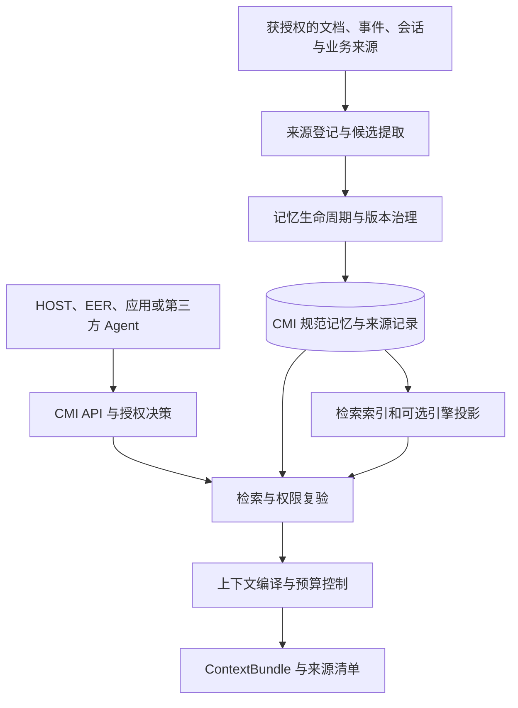
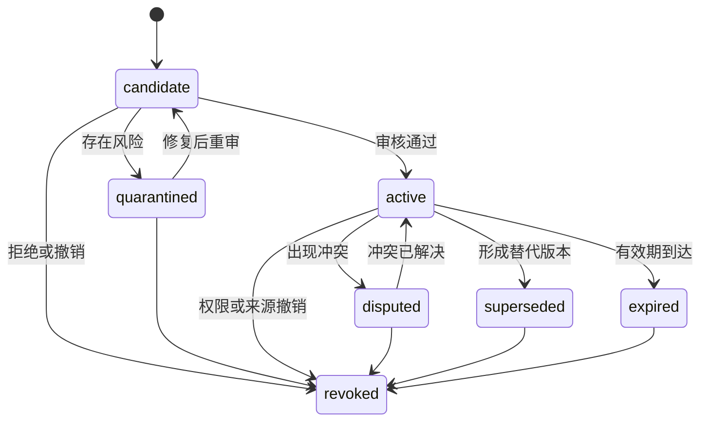

# IDP CMI 企业上下文与记忆基础设施白皮书

## IDP Context & Memory Infrastructure

**版本：V1.0｜日期：2026-11-04｜产品白皮书**

**面向对象：** 企业管理者、产品负责人、架构师、安全与数据治理团队、AI 平台及业务系统团队。

> **定位**：定义 IDP CMI 的产品边界、目标架构、记忆治理与实施要求。涉及部署、性能、安全和产品完成度的结论，以实际工程及验收证据为准。

---

## 目录

1. 执行摘要
2. 为什么企业需要 CMI
3. 产品定位与责任边界
4. 总体架构与处理链路
5. 记忆对象、类型与来源
6. 组织、团队、个人与业务对象记忆
7. 记忆生命周期与优化机制
8. 检索、上下文组装与模型协作
9. 权限、安全、隐私与数据治理
10. 数据架构与一致性
11. 与 IDP 及第三方系统集成
12. 业务应用场景
13. 部署、运行与故障处理
14. 质量评估与验收
15. 当前工程状态与实施路线
16. 风险、待决策事项与术语
17. 文档依据与参考资料

---

## 1. 执行摘要

企业中的有效信息分散在业务系统、制度文档、项目资料、人员沟通和历史执行记录中。AI Agent 如果只能看到当前对话，容易遗漏客户约定、项目决议与历史经验；如果把所有历史信息直接喂给模型，又会产生权限越界、信息过期、上下文膨胀与来源不可追溯等问题。

**IDP CMI 是独立的企业上下文与记忆基础设施。**它面向获授权的应用、Agent 和其他系统，围绕来源登记、记忆生命周期、受控检索和上下文组装，提供可复用、可治理、可追溯的上下文能力。

CMI 设计为可独立部署并通过版本化契约与其他系统组合。它管理自身的记忆与来源元数据；业务订单、库存、运单、正式制度等事实仍以相应权威业务系统或制度管理系统为准。CMI 不承担业务事务提交，不接管 HOST 会话状态，也不替代 EER 的执行状态、核验与证据。

本白皮书提出的核心能力包括：

1. **分范围记忆**：支持企业、组织、团队、项目、个人和业务对象等作用范围，并按身份、用途和资源授权访问。
2. **记忆优化**：对候选信息进行选择、去重、冲突识别、版本更新、失效处理和受控压缩。
3. **可信检索**：区分来源、权威性、有效时间与推断结果，先执行访问约束，再进行相关性排序。
4. **上下文组装**：围绕当前任务、权限及模型预算，形成带来源引用和版本信息的上下文包。
5. **可替换技术组件**：CMI 自有契约和治理逻辑不依附具体记忆引擎或搜索产品。

**建设阶段**：现有工程资料包含 CMI 工程原型和数据库安全验证包。自动提取、语义合并、跨范围上下文组装、向量检索及完整企业治理属于目标能力，需以实际交付和验收证据确认。

## 2. 为什么企业需要 CMI

### 2.1 面临的问题

| 企业问题 | 如果缺少治理 | CMI 希望提供的能力 |
|---|---|---|
| 信息分散 | 不同系统和人员重复寻找客户约定与业务依据 | 授权来源登记、关联与检索 |
| 跨会话工作 | Agent 反复询问已经明确的偏好和项目背景 | 受控的长期记忆与任务上下文 |
| 规则变动 | 历史规则被误当作当前制度 | 有效期、来源版本、变更与失效 |
| 多人协作 | 个人经验无法沉淀，或个人资料被过度共享 | 个人与组织范围、显式共享和权限 |
| 大量历史内容 | 模型收到冗余内容或遗漏关键内容 | 去重、排序、预算和出处 |
| AI 结果可信度 | 模型总结被误认作权威业务事实 | 声明类型、来源引用、审核和复核 |

### 2.2 产品价值与衡量方式

CMI 的价值应在真实场景中衡量，而不是预先假定使用后一定提高效率。建议与不使用 CMI 的基线比较：员工查找信息所需时间、任务完成率、人工纠错量、过期信息引用次数、来源可追溯率、授权违规测试结果，以及模型调用与基础设施成本。具体目标值和评估数据集须由实施方结合业务确定。

## 3. 产品定位与责任边界

### 3.1 定位

IDP CMI 是面向企业的 **Context & Memory Infrastructure**，能够为不同应用和运行时提供统一的记忆、知识索引及上下文能力。这里的“统一”指统一契约与治理方式，不要求把企业所有原始业务数据复制到 CMI。

### 3.2 责任分工

| 系统 | 自己拥有的职责或权威数据 | 与 CMI 的可选关系 |
|---|---|---|
| **业务系统及制度来源** | 各自领域的订单、库存、运单、客户信息、正式规则等 | 通过授权接口或事件提供来源引用；当前事实由其权威源确认 |
| **IDP HOST** | 会话、AgentRun、交互与自身工具调用责任 | 可请求 CMI 记忆和上下文；HOST 对本次运行和工具调用负责 |
| **IDP EER** | 执行状态、核验、Evidence、Execution Record 等 | 可提供获授权的事件/证据引用或查询经验；原始执行记录仍归 EER |
| **IDP MCP Infrastructure** | MCP 连接、注册、路由及其传输/接入治理 | 可与 CMI 的可选适配器集成；CMI 仍须执行自身数据授权 |
| **IDP Workspace、业务应用与第三方 Agent** | 自身的工作界面、业务对象和应用职责 | 可作为经授权的上下文消费者或来源提供方 |
| **IDP CMI** | 记忆元数据、来源关联、生命周期、受控检索和拟议的上下文组装 | 对外提供记忆和上下文服务，不拥有外部业务事务 |

不变量：CMI 不可用时，HOST、EER 和业务系统应按照各自设计处理缺失的上下文；CMI 不能因此让已绑定的在途业务动作自动切换执行后端。CMI 无 HOST/EER/MCP 仍可提供其自身已配置的核心服务；独立并不意味着不需要数据库、身份或其他运行依赖。

## 4. 总体架构与处理链路

### 4.1 逻辑架构

图示为目标逻辑能力，不表示每个方框均已开发或必须单独部署。安全策略、审计、来源有效性和撤权控制应贯穿写入、检索、组装和复用过程。

### 4.2 三条主要处理链

**写入链**：可信身份及来源登记 → 内容分类 → 候选提取或人工提交 → 来源和范围校验 → 去重/冲突判断 → 生命周期决策 → 规范版本提交 → 异步索引投影。

**检索链**：认证 → 得到可访问范围 → 精确与全文检索，按需组合语义检索 → 依据状态、来源及有效时间过滤 → 在合法候选内排序 → 返回前复验权限与当前版本。

**组装链**：接收任务及预算 → 选择获授权内容 → 区分事实引用、历史案例、偏好和建议 → 去重与冲突标记 → 预算内组装 → 形成可追溯清单 → 消费时按约定重新验证。

## 5. 记忆对象、类型与来源

### 5.1 五种概念类型

| 类型 | 典型内容 | 主要要求 |
|---|---|---|
| 工作记忆 Working | 当前任务的临时中间信息 | 适用时间及责任边界明确；不接管 HOST 工作状态 |
| 情景记忆 Episodic | 某次事件、交互、异常处理及复盘 | 保留时间、事件和来源引用 |
| 语义记忆 Semantic | 经治理的知识陈述、规则引用及关系 | 表明权威领域、来源、版本和有效期 |
| 程序性记忆 Procedural | 可复用的经验、方法和操作建议 | 候选方法与已批准规范分开，不自动授予执行权限 |
| 上下文快照 Context Snapshot | 某次上下文包的来源、版本和构建清单 | 权限、模型/编译版本及保留策略可追溯 |

类型是逻辑分类，不意味着必须建设五套数据库。现有原型请求类型还包含 `preference`；类型枚举及与上述分类的映射应在正式契约中统一。

### 5.2 核心对象

| 对象 | 职责 | 关键属性示例 |
|---|---|---|
| `SourceRecord` | 标识信息来自哪里 | 租户、来源系统、对象标识、版本、时间、内容定位、分类、来源权限 |
| `MemoryRecord` / `MemoryRevision` | 表示记忆及其版本 | 作用范围、主体、记忆类型、陈述、状态、来源引用、有效时间、版本 |
| `ContextBundle` / Manifest | 记录一次上下文组装结果或引用清单 | 请求者、用途、引用版本、策略版本、模型预算、有效期及清单摘要 |
| 授权与可见性控制 | 约束谁在何种用途下访问什么 | 主体、资源、操作、目的、授权版本和撤权屏障 |
| 事件与投影记录 | 跟踪规范提交到检索索引的传播 | 事件 ID、记忆版本、投影代际、处理状态 |
| 审计及删除操作 | 保存允许保留的管理证据 | 动作、主体、时间、策略结果、删除进度与最小凭据 |

以上是目标语义，不是已经最终冻结的 API 或数据库字段表。置信度表示提取模型对结果的评分，不能证明来源真实或使其成为正式政策。

#### 5.2.1 记忆记录的核心字段

| 字段组 | 语义要求 |
|---|---|
| 标识与作用域 | 租户、记忆标识、范围类型/标识、关联项目或业务对象；主体引用不替代授权 |
| 内容与类型 | 原子陈述、语言、记忆类型、声明类型；事实、建议和政策引用分别标识 |
| 来源与派生 | 一个或多个来源版本、定位、必要依赖、提取或摘要方式；引用本身不证明真实性 |
| 时间 | 业务有效期、来源时间、系统登记时间；开放区间和不确定时间应明确表达 |
| 版本与状态 | 修订号、候选/有效/存疑等状态、替代关系、更新原因及并发前置版本 |
| 安全与治理 | 资源权限、数据分类、允许用途、保留策略、撤权状态和必要审批引用 |
| 模型与优化 | 可选模型/embedding 配置、处理版本及置信度计算方式；不能把置信度当作权威性 |

字段是否必填和是否对外暴露应由经评审的版本化契约定义。对原始文档、上下文文本和敏感定位信息的保存、展示及外发遵循相应权限和保留策略。

#### 5.2.2 实体与关系

企业、用户、客户、供应商、项目、运单等实体应使用包含租户、来源系统、实体类型和来源标识的稳定命名空间。名称相同或 embedding 相近只能产生待核对的关联候选，不能自动合并不同主体；别名、关系、来源和适用时间应可追溯。业务主数据的最终身份仍由相应权威系统管理。

### 5.3 时间与权威性

- **业务有效时间**表示一项陈述在业务上何时适用；**登记时间**表示 CMI 何时记录它。两者需区分。
- 可考虑按“在某个业务时点，系统在某个登记时点已知什么”查询历史，但当前原型未实现完整的双时态查询 API。
- `recorded_at` 和生成 ID 不天然构成跨事务的严格提交全序。需要严格全局历史快照时，应另行设计一致性快照及恢复机制。
- 在回答“现在的订单状态”时，实时业务系统是权威来源；CMI 的旧快照和模型总结不能替代当前业务查询。

## 6. 组织、团队、个人与业务对象记忆

### 6.1 范围模型

| 范围 | 示例 | 典型访问规则（建议） |
|---|---|---|
| 租户 `tenant` | 企业共享的业务政策 | 按企业政策和用户角色授权，不默认全部成员可读 |
| 组织 `organization` | 某法人、部门的工作规范 | 依实际组织模型、成员资格和资源策略决定 |
| 团队 `team` | 美国线路团队的操作经验 | 团队授权范围内可用，受资源分类和用途限制 |
| 项目 `project` | IDP Parcel 项目决议 | 按项目身份、阶段和资料权限决定 |
| 个人 `user` | 员工语言或报告偏好 | 建议默认本人及明确授权的代理可用；企业管理权限由适用政策约束 |
| 业务对象 `business_object` | 客户、运单、供应商的历史案例 | 依对象权限、用途及来源权限决定 |

原型已有上述 `scope.type` 枚举与单范围查询。**跨多个范围的统一检索、组织层级解析、完整个人共享和资源级企业授权尚未完成。**企业需要先定义一个 `organization` 对应法人、部门还是其他组织单元，不能从名称直接假定层级关系。

### 6.2 共享和授权建议

1. 可信身份上下文确定租户、主体、工作负载和委派关系；客户端自报租户或“我有权限”不能作为授权结论。
2. 一条记忆至少有明确的可见范围、数据分类、用途及来源权限；对象关联和陈述主体不等同于授权范围。
3. 个人记忆成为组织共享记忆时，采用显式的共享或发布流程，按需要脱敏并记录来源；不自动提升可见范围。
4. 一个用户属于多个企业或组织时，按租户和授权分别判断；同名用户或相同文本不构成共享依据。
5. 成员离职、转组或授权撤销后，新请求重新评估权限；缓存、旧上下文包和派生索引不得绕过当前访问判断。
6. 来源的访问限制应传播到依赖该来源的派生记忆和摘要。多个来源合并时，应分别追踪依赖并采用足够严格的组合策略；不能因摘要而放宽任一必要来源的权限。

### 6.3 多维授权模型

一次记忆访问至少涉及以下彼此独立的维度：

| 维度 | 关键内容 | 权威责任 |
|---|---|---|
| 租户 | 企业或隔离域标识 | 从可信身份与租户映射解析；不能由请求体自行确权 |
| 请求主体 | 真实用户、服务账号、Agent、所属组织 | 身份服务验证主体及当前状态 |
| 委派关系 | Agent 代表谁、以何种授权访问 | 验证委派人、受托人、授权范围与有效期限 |
| 资源 | 记忆、来源、业务对象、项目和上下文包 | 资源所有者与策略服务提供当前访问条件 |
| 操作与目的 | 查询、提出、修改、共享、批准、删除及使用目的 | 按独立权限和处理目的分别判断 |
| 数据约束 | 分类、驻留、期限、来源限制和使用条件 | 企业数据治理与策略服务管理 |

对受保护资源，CMI 根据可信租户、主体与委派、操作目的、目标资源、数据分类以及该陈述所必需的来源权限进行综合判断。查询前构造获授权范围；候选返回及上下文消费前按约定复核当前状态。权限无法判断时拒绝受保护内容访问，不以旧缓存作为当前授权。

`scope` 用于表达记忆的作用或归属；`subject` 表示陈述涉及的对象；`principal` 表示请求者；三者不能互相替代。同一个人属于多个组织或租户时，应按当次可信身份、任务上下文和授权分别解析。

### 6.4 来源依赖与跨范围共享

记忆、摘要、向量、索引和上下文包应保留其依赖的来源版本和派生关系。一条陈述必须同时依赖多个来源时，访问不能弱于任一必要来源的限制；如果来源是可独立支持陈述的替代依据，只能使用调用方有权访问且足以证明该陈述的来源分支。

个人信息转为团队知识应经过显式共享或发布，并按用途控制可见范围；不能由于共同项目、文本相似或摘要合并而自动扩大权限。组织管理员的策略管理权限不自动等同于读取所有员工的私人记忆。来源撤回、人员离职或授权改变后，应使受影响的派生内容失效、重算或重新授权。

### 6.5 面向不同角色的记忆管理

| 角色 | 应提供的能力 | 授权边界 |
|---|---|---|
| 个人用户 | 查看获授权的个人记忆、来源、纠错、共享及删除请求 | 仅访问本人及被明确授权的内容 |
| 团队/业务负责人 | 复核组织知识候选、冲突、有效期和批准记录 | 按其职责和资源权限管理组织信息 |
| 租户管理员 | 配置记忆策略、作用域、保留规则和系统状态 | 管理权限与读取个人明文权限分别授予 |
| 审计与安全人员 | 查看经授权的操作记录、风险事件和处理状态 | 遵循最小化和脱敏策略 |

界面应区分请求已提交、访问已阻断和删除已完成；不应在异步删除尚未核验时显示“全部删除完成”。

## 7. 记忆生命周期与优化机制

### 7.1 生命周期

设计中的记忆可能处于：`candidate` 候选、`active` 可用、`quarantined` 隔离、`disputed` 存疑、`superseded` 已被替代、`expired` 过期或 `revoked` 已撤销。正式转换需有权限、原因、来源和预期版本检查。

擦除是另外跟踪的受控过程。技术设计使用同步可见性屏蔽、异步净化及完成验证，并通过最小化凭据记录状态；不要求在记忆表内保留一个带明文的 `erased` 记录。

### 7.2 优化闭环

| 阶段 | 关键问题 | 建议处理 |
|---|---|---|
| 选择 | 是否值得成为记忆？ | 依据内容类型、任务价值、用户设置和数据处理目的形成候选 |
| 分类 | 属于谁、是什么、可保留多久？ | 确定租户、范围、主体、分类、来源、有效时间和策略 |
| 对齐 | 与已有记忆是什么关系？ | 在允许的同租户、权限、范围和业务语义内查找候选 |
| 决策 | 新增、补充、替代、忽略还是复核？ | 根据来源权威、时间、冲突和策略形成可解释决策 |
| 使用 | 当前任务是否应该得到它？ | 先授权与有效性判断，再做相关性排序和上下文预算 |
| 维护 | 是否发生变化、撤权或应删除？ | 版本更新、失效、隔离、归档或按政策删除 |

这些环节是设计目标。现有原型接受调用方提交的候选文本，未实现完整的自动提取、语义去重或反思。

### 7.3 去重和合并

建议先检查语义之外的条件：租户、记忆范围、主体、业务对象、用途、分类、有效时间、来源和权限是否允许合并。语义相似只能作为候选依据，不证明两条陈述具有相同含义。

例如，一位用户多次表示喜欢“报告先给结论”，可以考虑归纳为一条偏好并关联原始来源；不同员工表达相同偏好时，仍分别属于各自的个人范围。对两个来源权限不同的企业知识，不得因为生成了共同摘要就扩大访问范围。

合并决策应可解释、可撤销；存在范围、事实、来源权威或时效差异时保留独立记录或进入复核。

### 7.4 冲突、更新与反思

- **个人偏好**：在用户明确表达、来源可靠且策略允许时，可以形成新版本；对有歧义的范围或冲突应请求澄清或保留待确认状态。
- **组织知识与规则**：对未经验证的聊天或模型输出只形成候选；正式规则引用以对应权威制度及其批准状态为准。
- **业务事实**：从领域系统验证当前状态；无法获取时清楚标记“未核实/来源不可用”，不把历史记忆填充为当前事实。
- **经验反思**：可利用 AI 从已授权的历史过程形成建议候选，但不得把模型反思直接升级为企业政策、EER 验证结果或业务执行指令。
- **并发与重试**：写操作应使用幂等键及预期版本；冲突时重新读取并按授权策略决定后续处理。

#### 7.4.1 记忆整合决策

| 决策 | 典型条件 | 必要记录与控制 |
|---|---|---|
| 新增候选 | 合法范围内没有等价陈述 | 来源版本、范围、时间、提取方式和风险类别 |
| 保持不变 | 新旧陈述在主体、范围、含义和时间上等价 | 决策理由及来源是否被采纳 |
| 合并候选 | 重复内容经范围、权限、时间和语义判断后相容 | 对每个必要来源保留依赖；合并可撤销 |
| 建议替代 | 新陈述具有明确适用范围、时间及可信来源 | 旧版本、新来源、决策主体及必要审批 |
| 标记冲突 | 来源或时间存在矛盾且无法判定 | 保留双方依据和冲突状态；不静默覆盖 |
| 停用或删除 | 到期、来源撤回、授权变更或擦除请求 | 分别跟踪阻断、历史保留及净化结果 |

整合操作先经过可信身份和范围验证，再执行候选比较、风险策略判断和预期版本检查；规范提交与必要事件在同一事务中完成。低风险个人偏好在策略许可时可自动处理，高影响组织规则和程序性经验应由可信来源及相应审批控制。对语义不明确的信息保持候选或请求澄清。

### 7.5 失效、遗忘与删除

失效表示不再作为当前有效记忆使用；归档或保留历史版本用于授权范围内回溯；擦除则是依据适用政策删除或不可恢复地销毁相关明文及其派生副本。三者不能混为一谈。

临时信息可配置有效期；正式制度依据来源版本和生效/废止时间管理；历史案例保留价值由业务与数据治理共同决定。不应统一地按使用频率自动删除重要政策或证据。备份的物理清除和到期轮换按单独策略跟踪，不虚称即时全域删除。

### 7.6 持续优化的三个时点

1. **写入时**：选择有价值信息，分类、绑定来源与范围，处理明显重复和冲突；保证主写入延迟与风险可控。
2. **后台整理时**：在授权范围内检查过期、重复、来源变更和低质量内容；需要模型生成的摘要或反思作为派生候选，按策略审批并保留依赖。
3. **检索时**：依据当前任务、时间、权限和预算选择内容；识别多个有效来源之间的冲突，对证据不足的部分明确提示或拒答。

各时点独立记录处理版本和结果。后台任务不得以整理名义跨租户合并、扩大共享范围，或把模型建议直接提升为企业正式政策。优化效果应通过错误合并率、重复保留率、过期引用及业务任务结果衡量。

事件型记忆与结构化关系可以互补：事件保留发生经过和上下文，结构化关系方便检索实体和有效时间。选择何种表示、是否增加图投影，应由任务质量与成本评估决定，而不是因为某类研究方案有效就视为所有企业场景必需。[T16]

## 8. 检索、上下文组装与模型协作

### 8.1 受控检索

目标检索按授权范围构造候选集，然后考虑精确标识、全文、语义和可选关系检索。运单号、渠道代码、合同编号等应保留精确查询路径，不能只依赖语义相似度。中文分词、同义词、向量模型和多租户过滤策略应通过真实任务数据验证。

候选结果需要映射回 CMI 的规范记忆及来源版本；不透明引擎给出的一段答案不能自动视为可用的权威记忆。结果返回前复核状态、来源、范围、用途和当前授权；权限或策略无法确定时拒绝受保护的数据访问。

**排序只能在通过硬约束之后进行。**相关性、业务权威领域、时效、来源质量和多样性可作为排序因素；任何固定权重均需通过测试集校准，而不是预先宣称最优。

#### 8.1.1 查询路由

| 查询类型 | 检索方式 | 返回前必须检查 |
|---|---|---|
| 运单号、渠道代码、合同号 | 精确标识及命名空间匹配 | 租户、对象权限、来源状态、是否存在同号不同对象 |
| 中文业务描述或自然语言 | 全文检索，按需结合语义候选与重排序 | 范围、来源权限、中文分词质量和召回覆盖 |
| 某时点的规则与历史 | 按业务有效时间、登记时间及版本筛选 | 当前读取权限、来源是否被合法擦除、时间语义 |
| 客户、供应商及项目之间的关系 | 对已授权实体和关系做受限关联查询 | 每条路径和必要来源的权限与有效期 |
| 证据不足或权威源不可用 | 返回缺失、冲突或需要重新核实 | 不以语义相似但未经验证的内容填补事实 |

检索允许使用关键词、语义、实体和关系的候选融合；融合与排序仅在授权边界内进行。向模型、重排序服务和外部引擎发送内容前也应验证授权及数据外发策略。与当前业务状态有关的问题，必要时调用方应重新查询权威业务系统。

近似向量索引可能在索引扫描后执行部分过滤，导致高过滤场景的候选不足。安全要求是未授权内容不能被返回或传递给模型；召回质量要求则需另用同一授权子集上的精确检索作基线，按过滤率评估。可根据结果评估迭代扫描、分区、受控候选集合或其他索引策略。[T2]

### 8.2 Context Compiler

目标能力是把当前任务所需的合法信息整理为 `ContextBundle`，而不是把全部历史数据提交给模型。其输入建议包含任务引用、可信主体及用途、相关业务范围、模型/tokenizer 配置、预算和时间条件；输出建议包含分段内容、来源及版本、策略版本、预算使用、缺失原因、有效期限和清单摘要。

预算应为系统消息和期望输出预留空间，计算来源标记成本；必要信息放不下时应明确报告预算不足，而非静默删除限定词、数字或引用。摘要是派生内容，需要保留来源、时间及权限依赖。

Manifest 哈希可以帮助验证清单是否变化，但不能单独证明 HOST 实际向模型发送了完全相同的内容。完整 prompt 是否保存以及可否复现，由授权和保留策略决定。

#### 8.2.1 上下文包的逻辑结构

| 字段组 | 含义 |
|---|---|
| 任务与身份 | 任务引用、可信请求主体与委派、租户和处理目的 |
| 内容分段 | 当前任务信息、权威来源引用、历史案例、经授权偏好、建议及冲突说明 |
| 来源清单 | 每段必要的 `memory_id/revision`、`source_id/revision`、适用时间和来源类型 |
| 预算与模型 | 模型/tokenizer 配置、允许预算、已使用预算、系统和输出预留、是否精确计数 |
| 策略与时效 | 策略版本、编译时间、有效期限、投影状态及复验要求 |
| 不足与遗漏 | 缺失的权威来源、权限受限、冲突、过期、索引延迟或预算不足等原因 |

此结构表达目标语义，不是对外接口字段的最终冻结。摘要和检索片段作为数据提供给调用方，不自行改变模型系统指令或工具权限。调用方应在约定的使用时点重新验证访问条件，并负责其实际模型输入与后续业务操作。

**回放边界**：引用清单可以在来源和权限仍允许时复查；字节级重放依赖合法保留完整内容及精确模型配置；语义结果的复现只能在模型、数据和运行环境允许时尽力而为。不能仅凭清单哈希声称外部模型处理结果完全可重现。

### 8.3 模型与记忆引擎的角色

规则方法可处理确定性身份、版本、状态及权限；语言模型可辅助候选提取、语义相似、冲突线索、摘要和经验建议。所有模型输出作为待验证的派生数据，不能自行决定资源授权、审批正式政策、改写权威事实或执行外部业务动作。

Hindsight、Mem0 等可作为适配器或对照 PoC 候选。外部引擎只处理经授权的派生数据；引擎结果需回映射至规范对象、来源与版本，并通过删除、隔离、重建和质量验证。CMI 不应要求安装任何一个特定外部引擎才能提供其核心能力。

### 8.4 防止记忆污染

外部网页、文档、事件和对话可能包含试图诱导模型的指令；它们应被标识为数据而非自动提升为系统指令。输入过滤、输出校验和模型提示均只能降低风险，不能代替最小权限、工具授权和高影响业务操作的受控执行。

安全控制覆盖内容进入、候选抽取、合并、召回、工具使用和清理全过程：模型不得自行赋予来源权威、扩大组织共享、批准正式政策或伪造业务核验。发现污染后，应阻断相关记忆、确定派生范围、复核历史引用并验证恢复过程；对合法数据的误删也需要具备受控修复机制。[T5][T6]

## 9. 权限、安全、隐私与数据治理

### 9.1 分层控制

1. **身份认证**：验证主体、签发方、接收方、凭据有效性及委派关系；服务端形成可信身份上下文。
2. **策略决策**：依据租户、主体、操作、用途、资源、数据分类、时间和来源权限做资源级判断。
3. **检索控制**：先限定可查询范围，取回结果后复核实际记忆版本及所有必要来源的权限。
4. **数据库隔离**：行级安全可作为纵深防御；普通应用角色不应拥有超级用户、`BYPASSRLS` 或不受控表所有者权限。数据库角色、连接池和策略需按实际部署测试。
5. **复用与撤权**：缓存和上下文包包含策略及资源版本，后续消费仍按约定复验；旧索引、队列重放和备份恢复不能使撤销内容重新可见。

PostgreSQL 文档说明，超级用户和具有 `BYPASSRLS` 的角色会绕过行级安全；表所有者通常也会绕过，除非配置适用的强制规则。RLS 因此不能单独替代可信身份和资源策略。[T1]

### 9.2 敏感信息与外部模型

按企业策略决定哪些数据允许记录、嵌入、传递给外部模型以及保留多久。供应商、模型版本、数据驻留、训练使用及外传目的应可配置并经过评审。日志默认记录操作与必要引用，不默认保存完整敏感文本。

### 9.3 撤权与擦除

当权限撤销、来源撤回或删除请求得到授权后，建议先在规范读路径上同步阻断受影响内容，再异步处理记忆、源对象、向量和全文索引、缓存、快照与可选外部引擎。逐域记录结果、重试和验证；备份依据相应轮转与恢复政策处理。

策略服务不可用时不得用过期缓存证明权限仍然有效。审计及墓碑自身也可能具有可关联性，应最小化并遵循保留政策。

#### 9.3.1 传播边界与状态

撤权起点应定义为权威策略方确认撤销并完成 CMI 读屏障生效的时点；分别记录新请求阻断、规范数据处理、各索引/缓存/外部引擎处理、备份策略处置和验证结果。对已检索但尚未送达模型的上下文，在交付边界按约定重新校验；跨系统调用仍需明确并测试竞态窗口。

已经交付给调用方或外部模型的明文不能由 CMI 单方面收回。外部服务的保留、删除和再利用能力应由供应商设置、合同和技术证据另行确认。系统不得把“接受删除请求”“新请求已阻断”或“本地索引已清理”单独表示为所有副本均已物理删除。

擦除状态应支持待处理、进行中、部分完成、失败重试、策略例外及已验证完成；恢复数据时重新应用有效屏障和删除记录。审计证据不应保存被请求清除的明文或可还原摘要。

## 10. 数据架构与一致性

### 10.1 初期路线与候选

既有技术设计提出 CMI 自有规范账本和 PostgreSQL 全文检索优先，选定 embedding 配置后再引入 pgvector。后续研究将 PostgreSQL + pgvector 作为参考候选，并将 OpenSearch 和 PostgreSQL + OpenSearch 作为对照方案；**正式生产后端尚未锁定，也没有真实负载基准结论。**

| 组件 | 拟议职责 | 状态 |
|---|---|---|
| PostgreSQL | 规范记忆、来源、版本、治理状态、事务和 outbox 的候选存储 | 原型有 PostgreSQL 代码及迁移；部署和生产选型须验证 |
| PostgreSQL FTS | 初期关键词检索参考方案 | 原型有简单 FTS 和字符串匹配；中文质量需评估 |
| pgvector | 可选语义检索投影 | 候选，当前找到的原型未接入 |
| OpenSearch | 独立搜索或 Agentic Memory 能力的研究/PoC 候选 | 不作为首版强制依赖；尚无 CMI 环境实测 |
| Mem0 / Hindsight | 可替换记忆处理引擎候选 | 需比较提取质量、权限、来源映射、删除和迁移 |
| Graphiti 等图投影 | 多实体关系及时间查询的可选能力 | 在需求和收益经验证后评估 |
| 对象存储、缓存 | 来源对象、归档或加速的配套组件 | 按数据、部署与可测收益决定；不因本文锁定具体产品 |

pgvector 官方文档提示：近似向量索引结合过滤时可能返回不足的候选；共享多租户近似索引也可能影响召回和性能。应在目标过滤选择率下测试迭代扫描、分区或精确检索等方案，不能把这些质量问题简单等同于已经发生数据泄露。[T2]

### 10.2 规范事务与索引投影

推荐在同一数据库事务中提交规范状态/修订、必要的可见性屏障和 outbox 事件；全文、向量或外部引擎作为可重建投影，通过幂等消费者处理。应用端不直接分别双写规范库和搜索引擎后就假定两者一致。

投影允许存在延迟，需要公开处理状态和错误语义。对撤权和删除，查询必须以规范状态和当前授权为准，不能因为旧索引还没有更新就返回受限制内容。索引应支持重放、故障恢复、代际重建、乱序/重复事件处理及删除传播验证。

预期版本、幂等键和投影票据用于保护具体对象或具体写入；不能把普通序列号、UUID 或单个时间戳直接解释为可靠的全局提交顺序。

#### 10.2.1 并发与失败处理

- 来源首次并发写入需依靠唯一约束与事务处理竞争；冲突时返回可识别的业务结果或实施受限重试，不得产生未处理的服务错误和重复规范记录。
- 记忆内容或状态更新携带预期版本；相同幂等键和相同请求重试不得重复生效，同键不同请求必须返回冲突。
- 所有投影事件按记忆标识、版本和代际幂等处理；重复、乱序或旧事件不能覆盖较新的状态或复活被撤销的记忆。
- 外部索引不可用时，通过回放和重建恢复。未达到所需投影可见性时，应明确返回延迟状态或使用已验证的规范读取路径，而非伪装成“没有结果”。
- 跨来源合并和物理擦除不等同于普通追加修订；必须验证来源依赖、授权、保留要求及受控净化权限。

### 10.3 PostgreSQL 补丁与 RLS 验证

如最终采用 PostgreSQL，应按实际受支持版本及安全公告选择维护版本，并测试角色变化、连接池复用、策略撤销和查询计划缓存。PostgreSQL 官方公告 CVE-2026-14666 涉及特定角色或所有权变更后 RLS 策略缓存可能陈旧；PG 16 的修复起点为 16.15。是否触发取决于具体角色/策略和计划复用方式，不能据此推断现有 CMI 实例已经受影响或已经修复。[T3]

### 10.4 外部记忆技术的接入原则

| 技术方向 | 值得评估的能力 | CMI 的约束 |
|---|---|---|
| Mem0 | 用户/Agent 范围、候选提取与检索 | 固定版本测试；不假定添加接口自动覆盖、删除或实现完整权限管理 |
| Hindsight | 记忆保留、召回与反思 | 反思作为派生建议，必须可映射到规范记录与来源 |
| Letta | 文件化记忆、版本管理及后台整理 | Agent 对记忆的修改受企业作用域、权限及审批限制 |
| Zep / Graphiti | 来源 episode、实体关系及时间变化 | 图关系和来源链接不能单独证明事实真实或替代访问控制 |
| OpenViking | 摘要、概览和原文的分层导航 | 摘要必须继承来源/范围限制；按锁定组件版本进行许可评审 |
| OpenSearch | 混合检索和 Agentic Memory API | 不以实验性 retention 单独承担企业删除或保留义务 |

引擎接入需通过隔离、来源映射、生命周期、撤权删除、迁移重建、成本和质量验证。托管服务与开源版本的功能及条款可能不同，选型以实际版本为准。[T7][T8][T9][T10][T11]

## 11. 与 IDP 及第三方系统集成

### 11.1 HOST

HOST 可以在任务开始或关键步骤前请求上下文，消费有权限且仍有效的结果；模型选择、会话状态、用户交互和实际工具调用由 HOST 控制。CMI 缺失时 HOST 如何退化，由 HOST 自身决定。

### 11.2 EER

EER 的执行状态、核验及证据由 EER 负责。CMI 可以在授权下引用执行记录，形成历史案例或经验候选；不能把模型摘要写成 EER 已验证结果，也不替代 EER 的事务和补偿。

### 11.3 业务系统与 BIP

业务系统保有各自权威数据。连接方式可以是获授权 API、事件或其他约定机制；在适用场景下也可以评估与现有 IDP BIP 的集成。具体连接和数据同步方式须对照现有接口验证，本文不假定 BIP 或任何业务系统必须改造或重构。

### 11.4 MCP 与第三方消费者

CMI 可选提供符合 IDP 已确定的 MCP 2026-07-28 协议基线的适配器，并暴露受控的查询或候选提交能力；不引入旧协议兼容适配层。MCP 接入和传输层成功并不等于授予数据访问权，CMI 仍需执行自己的资源授权和审计。其他应用可通过版本化 API 集成。[T12]

协议无状态不等于应用上下文无状态。请求中的客户端描述、范围或用户标识不构成可信授权；CMI 必须独立验证主体、委派及资源权限。同一访问通过 API 和 MCP 适配器应遵循一致的记忆规则，并在没有 MCP Infrastructure 时保持 CMI 核心服务可用。

### 11.5 服务接口与实现状态

| 逻辑操作或接口 | 用途 | 当前工程资料状态 |
|---|---|---|
| `GET /cmi/v1/health/live`、`/health/ready` | 服务存活和就绪 | 已有原型代码；就绪语义仍需对接正式策略与依赖 |
| `POST /cmi/v1/sources/ingest` | 登记来源及版本 | 已有原型代码；来源对象及摘要真实性尚需验证 |
| `POST /cmi/v1/memories/propose` | 提交候选记忆 | 已有原型代码；自动提取与可信审批尚未完成 |
| `GET /cmi/v1/memories/{id}`、`POST /cmi/v1/memories/search` | 读取及基础查询 | 已有原型代码；资源级企业授权与混合检索需完善 |
| `POST /cmi/v1/memories/{id}/transitions` | 按预期版本转换状态 | 已有原型代码；审批引用尚未接入可信验证服务 |
| `POST /cmi/v1/contexts/compile` 与 Bundle 验证 | 编译并在消费前复核上下文 | 技术设计目标，当前可见原型尚未实现 |
| 删除请求和操作状态 | 发起擦除、跟踪阻断和各域清理 | 技术设计目标，当前可见原型尚未实现完整流程 |

请求主体、租户及权限必须从可信认证上下文获得。示例接口名称说明设计意图；正式发布前以经评审、版本化的实际 OpenAPI 和测试为准。

## 12. 业务应用场景

### 12.1 个人偏好与团队规范共同生效

某团队的已批准规范规定异常报告必须包含运单号和原因；员工 A 希望报告先展示结论。经授权的上下文可同时包含团队规范和 A 的展示偏好。A 的个人偏好不能让系统省略强制业务字段；员工 B 的偏好也不会因为语义相似而自动分享给 A。

这是目标工作方式。当前原型尚未完成多范围联合查询和 ContextBundle 自动组装。

### 12.2 Parcel 发货渠道异常

假设某客户已经有经授权、可追溯的规则记录：“收到的 `shouHuoQuDao` 有值时，使用该值；否则依当前配置映射。”

1. 调用方请求处理一笔渠道异常，提供当前任务及业务对象引用。
2. CMI 在授权范围内检索与客户、渠道和历史异常有关的记忆及来源；未获得授权的资料不返回。
3. 当前字段值、渠道配置及有效规则须从各自权威来源核对；历史记忆不足以证明本次字段值。
4. Agent 可形成带依据的处理建议。业务写入由获授权的业务后端及其既定执行路径处理；使用 EER 时，其执行和核验职责保持不变。
5. 结果经相应来源验证后，可形成情景记忆候选；是否进一步形成团队经验，由治理策略决定。

上述客户规则仅为解释本设计的假设示例，不代表任何当前客户的正式配置。

### 12.3 组织规则变更

企业正式制度更新后，来源系统发布受授权的新版本或由责任人提交变更；CMI 将新旧版本、来源和有效时间关联。规则尚未完成验证时可进入候选或存疑状态，不能只因一段聊天或一条模型摘要就宣布旧制度失效。旧案例需要回溯时，应标明其发生时间及当时适用的规则。

## 13. 部署、运行与故障处理

P0 建议优先采用模块化服务与必要的异步 worker，根据真实负载和团队责任再决定是否拆分微服务。具体语言、数据库版本、模型、对象存储及运行拓扑须经过项目评审；现有原型是 Python/FastAPI，不能把其他项目的技术偏好自动视为本项目已批准的重写决策。

| 情况 | 目标行为 |
|---|---|
| 外部记忆引擎不可用 | 已配置的 CMI 自有基本能力按设计运行，并报告可选能力降级 |
| 检索索引落后 | 按投影状态等待、使用经过授权的规范路径或报告延迟；不得伪装为可靠的空结果 |
| 来源系统不可用 | 说明当前事实无法实时核验；历史信息标注来源与时间 |
| 策略服务不可用 | 保护性拒绝受影响数据访问，不以旧授权缓存冒充当前授权 |
| CMI 不可用 | 调用方按自身策略处理；不能擅自改变已绑定的业务执行后端 |
| 异步事件重复或乱序 | 通过版本和代际检查、幂等处理；旧事件不能复活已撤销内容 |

运营指标应覆盖写入到可检索的延迟、拒绝/撤权、索引漂移、队列积压、删除传播、召回质量、模型调用成本和故障恢复。指标须按租户和敏感度合理聚合，避免在监控中暴露明文。

## 14. 质量评估与验收

### 14.1 评估集

建立经授权、脱敏和人工标注的数据集，至少覆盖：个人与组织范围、跨用户和跨租户访问、客户和运单编号、中文改写、来源撤回、新旧规则冲突、历史时点查询、提示注入、删除后恢复以及预算不足。应保留独立评估集，不用构建数据直接充当唯一验收数据。

评测分为四层：① 不依赖模型的身份、权限、事务和版本不变量；② 公开长期记忆任务中的多会话、时间、更新与拒答；③ 记忆污染、撤权、删除和修复的安全任务；④ 经授权的 IDP 业务案例及端到端人工核验。公开基准侧重不同任务，不能代替企业组织权限、真实成本和业务验证。[T13][T14][T15]

### 14.2 指标

| 维度 | 建议度量 | 验收说明 |
|---|---|---|
| 记忆正确性 | 错误提取率、无依据陈述率 | 按记忆类型与来源人工复核 |
| 去重质量 | 错误合并率、重复保留率 | 特别检查不同范围、不同时间和相似但不等价的内容 |
| 检索质量 | Recall@k、Precision@k 或 nDCG@k，精确 ID 命中率 | 在相同任务、数据、权限与预算下比较 |
| 时效性 | 失效内容被引用次数、更新到可检索的延迟 | 区分来源变化、规范屏蔽与索引传播时间 |
| 授权 | 跨租户、跨主体、撤权后未授权返回次数 | 覆盖的负向测试中要求零次成功；不能由此宣称绝对安全 |
| 溯源 | 可核对的来源引用覆盖率及正确率 | 检查引用是否能支持具体陈述 |
| 上下文 | 关键事实覆盖、冲突标注、预算与截断错误 | 与不使用 CMI 的基线比较 |
| 运维与成本 | P50/P95/P99、资源、索引/模型成本、恢复耗时 | 分规模、并发、冷/热缓存和过滤选择率报告 |

阈值、样本量、SLO 和客户合同要求需由实际场景决定；本文不声称这些数据已经测出。

### 14.3 建议准入门

- **独立性**：不安装其他 IDP 产品或可选记忆引擎，CMI 的已承诺核心能力可按配置运行。
- **真实性**：不把历史记忆、模型推断或已提交动作称为已验证的实时业务结果。
- **隔离与撤权**：跨租户、跨范围、来源撤回、缓存/Bundle 复用和权限服务故障负例通过。
- **一致性**：事务、并发、幂等、队列重放、版本冲突及索引重建有真实运行证据。
- **删除**：规范读路径阻断，相关派生域按政策完成处理并保留最小化完成证据。
- **性能与效果**：同任务对照基础方案，有可复验的原始数据和环境说明。
- **生产运营**：权限、模型和依赖供应链、备份恢复、告警、业务负责人和应急流程完成评审。

#### 14.3.1 最小对照组与证据

在相同授权数据集、任务、回答模型、提示、硬件及预算条件下，至少比较：不使用长期记忆、基础全文检索、必要时加入语义检索，以及通过安全前置门的可选引擎。无法完全控制变量时分别报告差异。

评测记录包含数据集版本、样本与标注规则、请求及证据引用、身份与策略配置、模型和索引版本、故障注入方式、原始结果、错误分析、时延与总成本。应分别评估写入/索引成本和查询/模型成本；任何收益比例或生产 SLA 均以实际测量为准。

#### 14.3.2 关键验收场景

| 场景 | 预期结果 |
|---|---|
| Alice 与 Bob 同属项目 | Bob 不因项目成员身份获得 Alice 的私人记忆 |
| 摘要包含公开及私有来源 | 仅能返回获授权且有充分独立依据的内容；不得泄露私有来源信息 |
| 客户正式规则改变 | 新旧版本、来源和适用时间可追溯；未经核验的聊天不覆盖正式规则 |
| 两个来源并发首次写入 | 无重复规范记录和未处理的 500；冲突或重试按契约处理 |
| 撤权发生在检索后、模型调用前 | 在约定交付边界阻断或重新验证，并如实记录无法撤回的已交付内容 |
| 被污染的历史经验被召回 | 不越权调用工具；可定位、阻断、清理并验证旧事件重放 |
| 超过上下文预算或权威源不可用 | 明确报告遗漏/不可核验，不静默补造实时事实 |

## 15. 当前工程状态与实施路线

### 15.1 当前可见证据

本节基于 2026-10-15 的 PR-01～PR-03 原型说明、2026-10-16 的 PR-03.1 验证包及其随附报告；未直接检查任何其他代码仓库或生产环境，不能推断后续是否另有开发。

| 事项 | 当前资料支持的结论 |
|---|---|
| 产品边界 | CMI 被定义为独立的上下文与记忆基础设施；具体工程解耦仍需验证 |
| 技术栈 | 可见原型是 Python/FastAPI、PostgreSQL 访问代码及迁移草案 |
| 已有原型代码 | 令牌校验、默认拒绝的 PoC 策略、来源登记、候选提交、生命周期转换、基础查询、事务 outbox 等 |
| 范围模型 | 支持 tenant、organization、team、project、user、business_object 等单范围数据模型与查询 |
| 测试记录 | 原型 QA 记录 25 项通过，1 项真实 PostgreSQL 集成测试在当时环境跳过；这是历史报告，不是本次新跑的测试 |
| 数据库安全门 | PR-03.1 文档在当时标记未对真实 PostgreSQL 执行；未见本次提供的后续通过报告 |
| 已知缺口 | 首次并发写入同一来源可能冲突；幂等键过期、回放 HTTP 状态等需修复或明确语义 |
| 企业治理 | 企业 PDP、真实审批来源验证、来源对象及摘要验证、完整擦除和 outbox worker 尚未在该原型中完成 |
| 高级记忆能力 | 自动提取、语义去重、冲突自动处理、多范围组装、Context Compiler、向量检索和外部引擎适配尚未由该原型证明 |

原型的 `approval_ref` 目前只进行形式检查，不是对可信审批服务的独立验证；开发环境中的来源 URI 前缀检查也不证明对象或哈希真实性。上述原型不能仅凭单元测试结果认定为生产就绪。

### 15.2 建议实施顺序

| 阶段 | 建议范围 | 关键退出证据 |
|---|---|---|
| **G0：现状与基础安全** | 固定原型来源；在一次性环境验证迁移、RLS、跨租户、并发及幂等；处理已知缺口 | 可复验的数据库测试和缺口处理记录 |
| **G1：可信记忆内核** | 接入可信身份与策略、来源验证和可核验审批；完善记忆生命周期、审计与撤权屏障 | 来源、权限、版本和撤权的正反例通过 |
| **G2：组织/个人记忆与上下文** | 组织映射、个人共享策略、获授权的多范围查询、基础 Context Compiler 和 Bundle 复验 | 多身份、多范围、权限撤销与预算测试通过 |
| **G3：记忆优化与混合检索** | 候选提取、受控去重、冲突处理、有效期策略；评估 embedding、中文全文和可选搜索后端 | 独立评估集、效果/成本与安全对照结果 |
| **G4：高级反思与生产运营** | 可选引擎/图谱、反思候选、业务试点、故障恢复和生产准入 | 真实场景验证、运营/SLO、安全和责任人评审 |

阶段是实施建议，不是已经批准的排期；功能可以在保证依赖和安全边界的前提下并行。不要把某个开源引擎或新搜索集群作为独立性的默认前提。

## 16. 风险、待决策事项与术语

### 16.1 主要风险与控制

| 风险 | 控制思路 |
|---|---|
| 过期记忆误当实时事实 | 保留时间和来源，必要时查询业务权威源 |
| 个人信息意外扩散为组织知识 | 默认受限、明确共享、来源权限传播、撤权复验 |
| 模型生成虚假规则 | 模型输出仅为候选；正式规则引用可信来源和审批 |
| 高相似内容错误合并 | 在租户、范围、主体、时间、来源及业务语义内评估；歧义复核 |
| 索引滞后或重放使已删除内容回流 | 规范屏障、版本复核、代际与删除传播验证 |
| 外部引擎形成供应商锁定 | 自有语义契约、版本映射、可重建投影和替换测试 |
| 提示注入和记忆污染 | 数据与指令分离、最小权限、候选隔离、输出验证和工具执行控制 |
| 检索效果不佳但成本增加 | 标注任务对照实验，分别衡量质量、延迟、成本和业务效果 |

### 16.2 产品与工程决策事项

1. 组织单元与企业身份系统的映射、团队/项目成员来源及同步方式。
2. 个人记忆默认范围、个人到组织的共享审批及可见性。
3. 每类记忆的来源要求、候选激活条件、有效期、归档及擦除政策。
4. PostgreSQL 正式版本、检索后端、embedding 模型及是否引入外部引擎；均以真实环境验证和审批为准。
5. 跨范围查询、上下文包失效和消费前复验的具体接口、SLA 与调用责任。
6. 首个业务试点、标注数据、验收阈值、数据负责人和生产运维责任。
7. 新增设计与既有核心规格、ADR、技术设计及真实代码之间的版本化变更管理。

### 16.3 术语

| 术语 | 说明 |
|---|---|
| SoR | 某领域事实的权威系统或记录来源 |
| Principal | 经可信认证的用户、服务或获委派代理 |
| Scope | 一条记忆的作用或可见范围；不能单独代替资源授权 |
| SourceRecord | 对原始来源及其版本的受控登记；登记本身不证明内容为真 |
| MemoryRecord | 可带来源、范围、时间及状态的记忆陈述 |
| ContextBundle | 围绕指定任务和授权形成的上下文结果或可追溯清单；目前为目标能力 |
| PDP / PEP | 策略决策点 / 策略执行点 |
| Outbox / Projection | 规范事务内的事件记录 / 可重建的检索或引擎投影 |

## 17. 文档依据与参考资料

### 17.1 IDP 内部资料

- [IDP CMI 架构 RFC V1.0](https://chatgpt.com/library?file_id=libfile_b27ce51466a481918a57925e6176c75e&account_id=personal)，2026-10-15，建议稿。
- [IDP CMI 核心规格 V1.0](https://chatgpt.com/library?file_id=libfile_d89d176553088191b5b8305624f3a9dd&account_id=personal)，2026-10-15，技术评审草案。
- [IDP CMI 技术设计 V1.0](https://chatgpt.com/library?file_id=libfile_d54386b772788191adc739c3ead6206a&account_id=personal)，2026-10-15，工程/安全/DBA 评审草案。
- [IDP CMI Build vs Adopt ADR](https://chatgpt.com/library?file_id=libfile_3b3a04de66288191a304ccd81fd16c51&account_id=personal)，2026-10-15，Proposed。
- [IDP CMI PostgreSQL / OpenSearch 技术路线研究](https://chatgpt.com/library?file_id=libfile_aa3a67fab1608191921a86965fd94905&account_id=personal)，2026-10-26，R0.1 研究草案。
- [IDP CMI PR-03.1 数据库安全验证包与原型](https://chatgpt.com/library?file_id=libfile_808cb7e96a74819182554388c2ceaf5e&account_id=personal)，2026-10-16；包含原型和验证脚本，并注明当时尚未执行真实数据库 Gate。

### 17.2 外部一手技术资料

下列资料用于核查技术能力和风险，不构成对 IDP 实现、性能、安全或生产适配的认证；访问核对日期为 2026-11-04。

- **[T1]** [PostgreSQL：Row Security Policies](https://www.postgresql.org/docs/17/ddl-rowsecurity.html)；[PostgreSQL 16：CREATE POLICY](https://www.postgresql.org/docs/16/sql-createpolicy.html)。
- **[T2]** [pgvector 官方文档：Filtering、Multitenancy 和 Iterative Index Scans](https://github.com/pgvector/pgvector)。
- **[T3]** [PostgreSQL 官方安全公告 CVE-2026-14666](https://www.postgresql.org/support/security/CVE-2026-14666/)。
- **[T4]** [OpenSearch：Filtering vector search results](https://docs.opensearch.org/latest/vector-search/filter-search-knn/index/)；不同引擎及过滤方式应按所选版本实测。
- **[T5]** [OWASP GenAI：Prompt Injection](https://genai.owasp.org/glossary/prompt-injection/)；[OWASP：AI Agent Security Cheat Sheet](https://cheatsheetseries.owasp.org/cheatsheets/AI_Agent_Security_Cheat_Sheet.html)；[OWASP Top 10 for Agentic Applications](https://genai.owasp.org/2025/12/09/owasp-top-10-for-agentic-applications-the-benchmark-for-agentic-security-in-the-age-of-autonomous-ai/)。
- **[T6]** [MemoryGraft：Persistent Compromise via Poisoned Experience Retrieval](https://arxiv.org/abs/2512.16962)；[MemSecBench](https://arxiv.org/abs/2607.27080)。两者为安全研究资料，不构成 CMI 测试结果。
- **[T7]** [Mem0：How Mem0 Adds Memory](https://github.com/mem0ai/mem0/blob/main/docs/core-concepts/memory-operations/add.mdx)；[Hindsight：Main Methods](https://hindsight.vectorize.io/developer/api/main-methods)。Mem0 开源和托管功能、更新与过期行为应按固定版本验证。
- **[T8]** [Letta：Memory & dreaming](https://docs.letta.com/configuration/memory)。
- **[T9]** [Zep：Context Graph Overview](https://help.getzep.com/graph-overview)。
- **[T10]** [OpenViking：Context Layers](https://github.com/volcengine/OpenViking/blob/main/docs/en/concepts/03-context-layers.md)；[OpenViking 仓库与许可](https://github.com/volcengine/OpenViking)。
- **[T11]** [OpenSearch：Agentic Memory APIs](https://docs.opensearch.org/latest/ml-commons-plugin/api/agentic-memory-apis/index/)；[Agentic Memory Retention](https://docs.opensearch.org/latest/ml-commons-plugin/agentic-memory-retention/)。
- **[T12]** [Model Context Protocol：2026-07-28 Specification](https://blog.modelcontextprotocol.io/posts/2026-07-28/)。
- **[T13]** [LongMemEval：Benchmark and Code](https://github.com/xiaowu0162/LongMemEval)。
- **[T14]** [AMA-Bench：Evaluating Long-Horizon Memory for Agentic Applications，ICML 2026](https://proceedings.mlr.press/v306/zhao26bs.html)。
- **[T15]** [MemSecBench：Memory Poisoning from Persistence to Consequence and Repair](https://arxiv.org/abs/2607.27080)，2026 年预印本。
- **[T16]** [APEX-MEM，ACL 2026](https://aclanthology.org/2026.acl-long.749/)；[Long-Term Agent Memory through Complementary Curation and Consolidation](https://arxiv.org/abs/2610.39790)，2026-10-29 预印本。公开实验的结果不能直接外推为 IDP 的效果。

[T1]: https://www.postgresql.org/docs/17/ddl-rowsecurity.html
[T2]: https://github.com/pgvector/pgvector
[T3]: https://www.postgresql.org/support/security/CVE-2026-14666/
[T4]: https://docs.opensearch.org/latest/vector-search/filter-search-knn/index/
[T5]: https://genai.owasp.org/2025/12/09/owasp-top-10-for-agentic-applications-the-benchmark-for-agentic-security-in-the-age-of-autonomous-ai/
[T6]: https://arxiv.org/abs/2512.16962
[T7]: https://github.com/mem0ai/mem0/blob/main/docs/core-concepts/memory-operations/add.mdx
[T8]: https://docs.letta.com/configuration/memory
[T9]: https://help.getzep.com/graph-overview
[T10]: https://github.com/volcengine/OpenViking
[T11]: https://docs.opensearch.org/latest/ml-commons-plugin/agentic-memory-retention/
[T12]: https://blog.modelcontextprotocol.io/posts/2026-07-28/
[T13]: https://github.com/xiaowu0162/LongMemEval
[T14]: https://proceedings.mlr.press/v306/zhao26bs.html
[T15]: https://arxiv.org/abs/2607.27080
[T16]: https://aclanthology.org/2026.acl-long.749/

---

**IDP CMI 的实施、部署和运行以经验证的接口、实际配置、评测结果及生产准入要求为准。**
