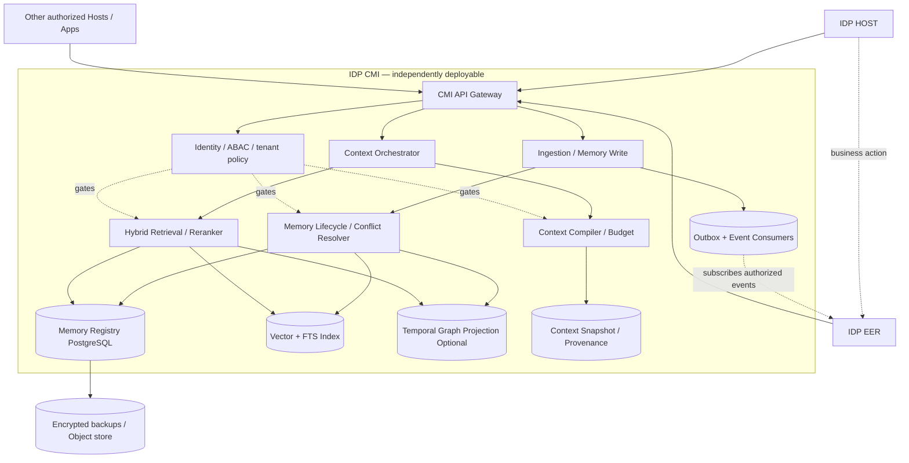

# IDP Context & Memory Infrastructure（IDP-CMI）

**Enterprise Memory & Context Infrastructure — Architecture RFC V1.0**  
**日期：2026-10-15**  
**状态：建议稿 / 待技术评审 / 尚未部署**  
**架构关系：IDP HOST、IDP EER、IDP CMI 三者独立运行，通过授权契约可选集成。**

---

## 0. 决策摘要

建议把上下文工程与企业长期记忆产品化为第三个独立技术资产 IDP-CMI。CMI 负责记忆对象生命周期、关系/时序索引、可追溯上下文构建、权限与审计；不负责企业业务事实的最终确权，不负责 EER 的意图准入、持久业务执行、补偿或结果核验，也不替 HOST 管理 Agent 会话与工作任务。

**边界不变量**：HOST 无 CMI/无 EER 仍能完成核心工作；EER 无 HOST/无 CMI 仍能进行既有可靠执行；CMI 无 HOST/无 EER 可向授权第三方消费者提供存取/检索/构建接口；任一服务故障不得导致已绑定执行后端的在途业务动作自动切换后端重试。

**初期技术路线**：IDP-owned API + PostgreSQL/pgvector + Redis + Object Storage（S3/MinIO）+ 可替换记忆引擎适配器（Mem0 与 Hindsight 对照 PoC）；有充分真实时序关系需求时引入 Graphiti 图谱投影。OpenViking 研究虚拟上下文文件系统与分层加载设计，商业采用前审查 AGPLv3 许可边界。

## 1. 目标和非目标

### 1.1 目标
1. Cross-session/agent/application：在授权范围内持续复用企业知识、用户偏好、历史案例、任务经验。
2. Source-grounded：每项记忆有原始来源引用、主体范围、有效时点、记忆版本与可信度。
3. Governed：跨租户隔离、访问控制、数据保留、删除、审计、模型/组件可替换。
4. Context-efficient：有 Token 预算约束的任务上下文检索、排序、压缩、组装。
5. Runtime-independent：可单独部署、测试、监控，API 合约不暴露具体记忆引擎数据结构。

### 1.2 非目标
- 不把向量索引、图谱或 LLM 生成的摘要作为实时订单/库存/运单的权威来源。
- 不将记忆/历史经验直接升级为具有执行权限的指令或“已批准政策”。
- 不代替 HOST 的 Session/WorkItem/AgentRun，亦不代替 EER 的 Execution State / Verifier / Evidence。
- 不承诺 exactly-once 业务副作用，也不根据记忆自行重新执行业务动作。
- 不预设三套记忆框架同时写入同一权威数据集。

## 2. 逻辑架构



这是**逻辑边界图**，不是要求一开始以每个模块一组微服务部署。P0 推荐模块化单服务 + 独立 worker + 既有可用的持久化组件，待 SLO 和组织责任证明有必要后再拆分。

### 2.1 组件规格

| ID | 模块 | 输入 | 输出 | 关键保证 |
|---|---|---|---|---|
| CMI-01 | API Gateway | 访问主体、租户、目的、请求 | 授权结果/响应 | OIDC/OAuth2、租户/资源作用域、配额、审计 |
| CMI-02 | Memory Ingestion | 会话/文档/结构化事实/事件引用 | SourceRecord + candidate memory | 数据清洗、去重、敏感信息与提示注入检测 |
| CMI-03 | Memory Lifecycle | candidate + old memory | new version / supersede / quarantine | 来源完整、冲突受控、可撤销、避免沉默覆盖 |
| CMI-04 | Retrieval | query、scope、as_of、principal | ranked sources | ACL 前置过滤 + 返回前复验、混合检索 |
| CMI-05 | Context Compiler | task、budget、model、sources | context bundle | Token 预算、信任等级标记、可复现清单 |
| CMI-06 | Temporal Graph | verified source、实体/关系 | temporal projection | 双时态或有效时态、来源链接，允许重建 |
| CMI-07 | Governance | policies、classification、retention | allow/deny/quarantine/delete | 默认拒绝、审计、PITR/擦除规程 |
| CMI-08 | Operations | metrics/events/traces | status、alerts、SLO | 指标、追踪、重建与灾备恢复 |

## 3. 数据语义：五类记忆，不等于五套数据库

- **Working Memory**：任务/会话工作态；TTL，可缓存 Redis；真正的 HOST AgentRun/WorkItem 状态仍归 HOST。
- **Episodic Memory**：任务、互动、异常案例、复盘的时间线；应附 EER Execution Record 或外部业务系统记录的 source ref。
- **Semantic Memory**：实体/关系/知识陈述/用户偏好/业务规则的可版本化表示；对于已批准政策必须保存 authority/version/effective_time，不得让 LLM 自动批准。
- **Procedural Memory**：提炼出的业务方法和操作建议；默认处于 `candidate` 状态，达到质量阈值且由合适责任人批准后才能成为可被引用的企业标准方法；即使批准也不自动获得执行权限。
- **Context Snapshot**：每次 Context Compiler 构建结果的引用清单、版本、授权决策、模型/tokenizer、时间、哈希与预算。是否保留完整 Prompt 依安全及保留策略而定。

### 3.1 Canonical MemoryRecord V1

```json
{
  "memory_id":"mem_01...",
  "tenant_id":"tenant_a",
  "scope":{"type":"business_object","id":"shipment:PK0179:ABC123"},
  "subject":{"type":"customer","id":"customer_42"},
  "kind":"episodic",
  "claim":"该客户历史上曾因门牌缺失导致面单创建失败",
  "status":"active",
  "confidence":0.91,
  "trust_class":"verified_source_derived",
  "classification":"internal",
  "source_refs":[{"system":"idp-parcel","uri":"parcel://event/xyz","hash":"sha256:..."}],
  "valid_from":"2026-10-14T00:00:00Z",
  "valid_to":null,
  "recorded_at":"2026-10-15T02:00:00Z",
  "supersedes":null,
  "retention_policy_id":"default_business_365d",
  "embedding_model":"model-name-version",
  "version":1
}
```

字段说明：`confidence` 只是抽取或推断置信度，不是**来源真实性证明**。`valid_from/to` 表示业务上被认为成立的时段；`recorded_at` 表示系统接收到该信息的时间。对权威事实的变更必须优先使用权威源事件而不是 LLM 猜测。`tenant_id`、`scope` 与 `source_refs` 为必要字段，数据分类由策略决定。

### 3.2 基本数据表（概念层）

- `source_records(id, tenant_id, source_system, source_object_id, source_version, observed_at, content_hash, classification, storage_uri)`
- `memory_records(id, tenant_id, scope_type, scope_id, kind, status, latest_version, trust_class, retention_policy_id)`
- `memory_versions(memory_id, version, claim, valid_from, valid_to, recorded_at, source_record_refs, supersedes, embedding_ref)`
- `memory_acl(memory_id, principal_or_group, purpose, granted_actions, policy_version)`（实际授权优先由统一 Policy/IdP 判定，非仅依赖此表）
- `context_snapshots(id, tenant_id, principal_id, task_ref, retrieval_manifest_hash, model_id, token_budget, composed_at, policy_version)`
- `memory_feedback(id, memory_id, source, rating, correction_ref, processing_status)`
- `memory_outbox(id, event_type, aggregate_id, payload, created_at, published_at)`
- `memory_audit(id, tenant_id, principal_id, action, target_ref, policy_decision, trace_id, timestamp)`

## 4. 三条处理管线

### 4.1 Write pipeline

`Authorized source → Normalization → Classification / Prompt-Injection Check → Candidate Extraction → Evidence Link → Identity Merge / Contradiction Check → Versioned Commit → Outbox → Async index/graph projections`

1. 授权来源映射为 SourceRecord，进行哈希与幂等去重。
2. 对来源分级：`authoritative`（仅对其权威领域）、`verified_document`、`conversation`、`external_untrusted`。
3. 从非结构化内容抽取 Candidate，不直接转化为执行策略；冲突进入 quarantine/review。
4. 先完成主账本事务，再通过 outbox 同步向量和图谱投影；索引结果最终一致。
5. 对同一个 `source + external_event_id + version` 保证幂等处理；消费语义按至少一次投递设计。
6. 写入事件带 `trace_id` 和 `source_ref`，方便追踪和回放。

### 4.2 Retrieval pipeline

`AuthN → Tenant/Scope/Purpose ABAC → Query expansion (optional) → Hybrid (FTS + Vector + Temporal/Graph) → Cross-encoder or LLM rerank (optional) → Freshness/Trust/Source ordering → ACL recheck → Return with citations`

筛选优先级：访问许可与目的限制（硬约束）→ 领域权威/实时性（硬约束或业务优先级）→ 相关性评分 → 预算。**不得用相关性高的无权限文档补足空缺**。对细粒度访问控制，应评估向量 ANN 对过滤召回的影响，必要时使用分区、严格前置过滤、精确检索或二段检索。

### 4.3 Context build pipeline

`TaskContext → Context Plan → Source Retrieval → ACL/Trust/Validity → Deduplication → L0/L1/L2 expansion → Token Pack → Provenance Manifest → ContextBundle`

预算示例（**初始试验参数，不是通用最佳比例**）：计划 10%、本轮任务状态 20%、权威业务事实 30%、长期记忆/案例 25%、执行工具 schema 与回执 15%。按任务类型配置，保留模型系统提示与输出空间。可采用 Mastra Observational Memory 的 Observer/Reflector 思路进行内容压缩，但观察笔记不能取代原始事实与证据。

## 5. API 合约 V1（IDP 自有，底层实现可替换）

所有请求必须由网关注入或校验不可伪造的 `tenant_id`、`principal_id`、`purpose`、`trace_id`；外部客户端不能通过提交任意 tenant_id 越权。

| Method | Endpoint | 用途 | 语义 |
|---|---|---|---|
| POST | `/cmi/v1/sources/ingest` | 受控来源写入 | 支持 `Idempotency-Key`，可异步返回 job_ref |
| POST | `/cmi/v1/memories/search` | 授权记忆检索 | scope + as_of + trust_class + citation refs |
| GET | `/cmi/v1/memories/{id}` | 获取有权限的记忆版本 | 返回 history/来源，按权限过滤 |
| POST | `/cmi/v1/contexts/compile` | 构建任务上下文 | token_budget、task、model_profile、retrieval manifest |
| GET | `/cmi/v1/contexts/{id}` | 查询上下文快照/元数据 | 仅授权主体可读 |
| POST | `/cmi/v1/memories/{id}/feedback` | 纠错/冲突反馈 | 不直接修改权威系统事实 |
| POST | `/cmi/v1/memories/{id}/invalidate` | 废弃/撤销记忆 | 保留合规审计，不返回失效记忆 |
| POST | `/cmi/v1/privacy/erasure-requests` | 擦除请求 | 审批、法定保留例外、索引级联删除 |
| GET | `/cmi/v1/health` | 健康检查 | 无 EER/HOST 依赖即可通过 |

**构建上下文示例**：

```json
POST /cmi/v1/contexts/compile
Authorization: Bearer <machine-or-user-token>
{
  "task":{"kind":"shipment_exception_review","business_ref":"shipment:ABC123","question":"为什么反复面单失败，建议下一步？"},
  "scope":{"customer_id":"customer_42","object_ref":"shipment:ABC123"},
  "as_of":"2026-10-15T09:30:00Z",
  "model_profile":{"model":"configured-llm","tokenizer":"configured-tokenizer"},
  "token_budget":6000,
  "include_kinds":["episodic","semantic","procedural"],
  "include_source_manifest":true
}
```

**响应必须区分事实与建议**：

```json
{
  "context_id":"ctx_...",
  "segments":[
    {"kind":"authoritative_fact_ref","content":"...","source_refs":["parcel://event/x"],"trust_class":"authoritative_for_shipping_state"},
    {"kind":"historical_case","content":"...","source_refs":["mem://..."],"trust_class":"derived_history"},
    {"kind":"suggestion","content":"...","source_refs":["mem://..."],"trust_class":"advisory"}
  ],
  "token_estimate":3270,
  "manifest_hash":"sha256:...",
  "policy_version":"p13",
  "retrieval_warnings":["source_state_requires_live_revalidation"]
}
```

MCP Adapter：建议仅暴露经授权的 `memory.search`、`memory.get`、`context.compile`、`memory.propose`、`memory.feedback`（工具名仅是 IDP 拟定的接口名）；高风险写入/擦除仅由服务端授权的 API 和审批流负责。遵循当前 MCP HTTP 授权协议，禁止把客户端传入的任意资源 URI 当作授权通过的证据。

## 6. 与 HOST / EER 的集成契约

### 6.1 HOST ↔ CMI

HOST 是会话和 WorkItem 的责任方；CMI 提供可选 Session Recall、可追溯 ContextBundle。HOST 在 Agent Run 启动/每次关键决策前，可请求 `context.compile`；成功时只消费已经授权的 Bundle。CMI 缺席时 HOST 仍可使用本轮会话、显式提供的资料和工具完成基本工作。由 HOST 控制本轮模型及最终工具调用，不让 CMI 擅自执行工具。

### 6.2 EER ↔ CMI

EER 的 Event/Execution/Verification/Evidence 为它自己的权威执行数据。CMI 订阅经过策略过滤的事件/结果引用以形成经验记录；EER 可以可选查询相似案例与已批准经验，但意图准入、状态转移、恢复补偿、Verifier 判定仍由 EER 自己负责。

示例：`ExecutionVerified` 事件 → 受控提取任务经验 → 等待验收或人工评价 → 合并为可检索案例；不得由 `LLM summary` 直接写成 `ExecutionVerified`。

### 6.3 Parcel / Prism / LOMS ↔ CMI

优先从授权的业务只读接口获取当前状态，历史事件经结构化事实抽取后用于相似案例检索。业务主键使用 `system:entity:external_id` 命名空间，避免企业之间/系统之间的 ID 碰撞。

## 7. 企业级安全和治理

1. **身份**：对接企业 IdP 的 OIDC；服务间短生命周期工作负载凭证，结合 gateway、mTLS 或同等保护；MCP HTTP 采用规范授权框架。
2. **授权**：tenant + principal + purpose + resource + classification + consent/contract policy；跨租户默认拒绝；数据库可使用 RLS 纵深防御，但不能只依赖 RLS。
3. **访问前过滤**：先实施授权范围限制再检索，检索返回之前再做策略复验；缓存键含授权范围和策略版本，撤权时失效。
4. **记忆污染**：外部文本不被执行为指令；防止恶意会话、网页、工具输出成为长期最高权限记忆；建立 `quarantine`、来源标记与审批机制。参考 OWASP ASI06 和 Agent Memory Guard。
5. **保留与擦除**：来源、记忆、向量、图谱、缓存、Context Snapshot 与备份的保留/擦除联动；对于法定保留、灾备备份应通过企业政策明确处置与到期清除，不能虚称瞬时全域物理删除。
6. **合规与解释**：所有写/读/合并/失效操作记审计；记录引擎版本、模型版本和索引版本；敏感数据加密及按需要脱敏。
7. **回放与修复**：原始 SourceRecord 与 MemoryRecord ledger 优先于可重建索引；重建需可追踪并可重新应用当前授权/删除策略。

## 8. 具体开源选型

| 路线 | 建议用途 | 优势 | 不确定性/风险 |
|---|---|---|---|
| Mem0 | 第一轮基础语义记忆候选 | 提取、更新、查询，OSS REST/SDK | 需测试删除传播、冲突、租户隔离集成 |
| Hindsight | 第一轮反思/经验学习候选 | retain/recall/reflect、可自托管 | 需验证实际数据上的错记与运营复杂度 |
| Graphiti | P1 时序知识图谱投影 | 双时态/来源/关系检索设计 | 图数据库运维和语义对齐成本 |
| OpenViking | 分层上下文/虚拟目录参考或受控独立 PoC | L0/L1/L2、资源记忆技能统一组织 | 主项目 AGPLv3，需商业许可审查 |
| Mastra Observational Memory | Observe/Reflect 压缩机制参考 | 控制长会话上下文膨胀 | 不能代替原始证据存储 |

**核心策略**：不将 IDP 的公开 API、租户权限、MemoryRecord 规范和 ContextBundle 直接绑定任一 OSS 的内部对象。对于 Mem0 和 Hindsight 实施相同数据集的对照测试，选一个做首期 Memory Engine；Graphiti 仅在必须回答时序关系问题时作为独立投影；不从一开始堆叠三个自动抽取器。

持久化 MVP：PostgreSQL + pgvector + FTS，Redis 作为工作态/缓存，S3/MinIO 作为来源对象仓库与审计相关归档。可暂不增加专用向量数据库或图数据库。租户多样性、数据体量和过滤策略达到阈值时，再评估独立索引技术。

## 9. IDP Parcel 验证用例

**场景：某跨境小包面单创建反复失败，错误涉及门牌、州省字段和地址编码。**

1. HOST 发起 `shipment_exception_review`，CMI 根据 shipment/customer scope 与访问主体检索。
2. CMI 返回客户历史地址异常案例、相关渠道约束的来源版本，以及针对该类错误的经验证处理建议；返回全部来源引用与有效时间。
3. HOST 或 EER 从 Parcel 实时只读接口取得订单及地址的当前权威值，确认该次失败的真实错误码与版本。
4. Agent 生成修改建议；如有写操作，依企业审批与责任后端契约执行。选用 EER 时仍执行 Intent Admission、Durable Execution、Verifier、Evidence；选用获准原生后端时需要该后端提供相应授权、幂等与结果确认。
5. 仅在业务结果已验证后，CMI 将处理过程与结果来源关联，写入 episodic memory；如要晋升为可复用 Procedural Memory，须验证及适当批准。
6. 下一次相似错误不直接复制旧修改结果：先检查当前地址与渠道规则，再建议操作。

## 10. SLO / 质量门槛（**初始验收建议，尚未实测**）

| 维度 | PoC 验收建议 | 说明 |
|---|---|---|
| 独立启动 | 三种单独部署场景均通过健康检查 | HOST/EER/CMI 无彼此启动依赖 |
| 权限 | 跨租户越权检索与访问 0 成功 | 以覆盖查询、缓存、图谱边和外部 MCP 为准 |
| 数据来源 | 关键企业事实回答 100% 附 source_ref | 不能证明回答一定真实，但满足可审计 |
| 删除 | 主存/索引/缓存按审批 SLA 完成联动 | 备份按独立保留/轮转策略验证 |
| 记忆新鲜度 | 可报告 ingestion→searchable 延迟分布 | 以分位数而非“实时”口号表示 |
| 检索质量 | Recall@K、MRR/nDCG、时序正确率 | 使用人工标注 Parcel 异常案例 |
| 错误安全 | 未授权写操作、恶意记忆注入不得触发业务动作 | 对攻击提示与工具返回做红队测试 |
| 可靠性 | 注入 DB/Redis/索引/模型不可用等故障 | 明确 fail-closed、降级与重试边界 |
| 成本 | tokens/task、cost/verified-outcome | 不仅看 LLM 输入 Token |

延迟与可用性目标（如 P95 500ms / 99.9%）应在数据集规模、缓存命中率、查询范围和运行环境明确后制定；不提前宣称达成。

## 11. 分阶段实施

**P0 | 1–2 周：契约与可部署 MVP**
- `MemoryRecord/SourceRecord/ContextBundle` JSON Schema 与表结构；身份、租户、scope 校验；PostgreSQL + pgvector；CI、单机 docker compose、基本 API；无 HOST/EER 启动测试。

**P1 | 2–3 周：记忆质量 PoC**
- 同组 Parcel 历史异常在 Mem0 与 Hindsight 上对照；比较检索质量、错误更新、延迟、模型消耗和运维复杂度；首期只选一个记忆引擎。实现来源哈希/冲突处理/反馈。

**P2 | 2–3 周：HOST + EER 双端接入**
- HOST Context Compiler 调用、可审计 Context Snapshot；EER 执行完成事件的只读/投影接入；真实业务状态仍由 Parcel/Prism/WMS 等查询；MCP adapter。

**P3 | 2–4 周：安全、时序图谱与生产化**
- 细粒度 ACL、撤权、红队测试、索引重建、灾备、度量；有真实价值时接入 Graphiti，验证过去时点事实和跨对象依赖检索。部署拆分仅在需求证明后进行。

以上为**评估性工作量区间**，非已承诺的排期。人员、现有源码质量、数据合规条件和测试环境不同会改变估算。

### 11.1 架构 Gate

- **G0 独立性**：CMI 无 HOST/EER 运行，HOST 无 CMI/EER 运行，EER 无 HOST/CMI 运行。
- **G1 数据正确性**：当前事实与历史记忆明确区分；不同来源冲突必须显式暴露。
- **G2 治理**：多租户隔离、跨资源 ACL、删除/撤权生效、注入防护通过。
- **G3 可替换**：替换 Mem0/Hindsight 底层不会更改 IDP 公共合约。
- **G4 价值验证**：对相同 Parcel 场景，与无长期记忆基线比较已验证任务完成率、人工耗时、成本与误操作。

## 12. 首轮需要决策的事项

1. **决定 CMI 的产品边界**：基础设施独立、长期开放 API；暂不设立独立商业品牌和销售线。
2. **决定权威主存**：IDP Registry 由 PostgreSQL 承担，OSS 引擎仅为可替换实现和索引。
3. **决定首轮引擎测试**：Mem0 vs Hindsight；Graphiti 作为第二阶段；OpenViking 暂先验证设计与许可。
4. **选第一个数据场景**：IDP Parcel 地址字段/面单创建异常；数据脱敏后建立 100–300 例标注评估集（建议规模，并非已有数据）。
5. **批准 G0–G4 验收条件**：在构建前形成自动化验收规范和可追踪测试矩阵。

## 13. 参考资料（访问日期：2026-10-15）

- MCP Architecture: https://modelcontextprotocol.io/specification/2025-11-25/architecture
- MCP Authorization: https://modelcontextprotocol.io/specification/2025-11-25/basic/authorization
- CloudEvents Spec: https://github.com/cloudevents/spec/blob/main/cloudevents/spec.md
- Mem0 OSS REST API: https://github.com/mem0ai/mem0/blob/main/docs/open-source/features/rest-api.mdx
- Hindsight: https://github.com/vectorize-io/hindsight
- Graphiti: https://github.com/getzep/graphiti
- OpenViking: https://github.com/volcengine/OpenViking
- Mastra Observational Memory: https://github.com/mastra-ai/mastra/blob/main/docs/src/content/en/docs/memory/observational-memory.mdx
- pgvector: https://github.com/pgvector/pgvector
- OWASP Agent Memory Guard: https://owasp.org/projects/agent-memory-guard

**说明**：以上为架构规格建议。对开源项目的功能判断基于官方项目文档；性能、契约适配、隐私与商业部署须在 IDP 环境中实测并进行许可证审查。 
