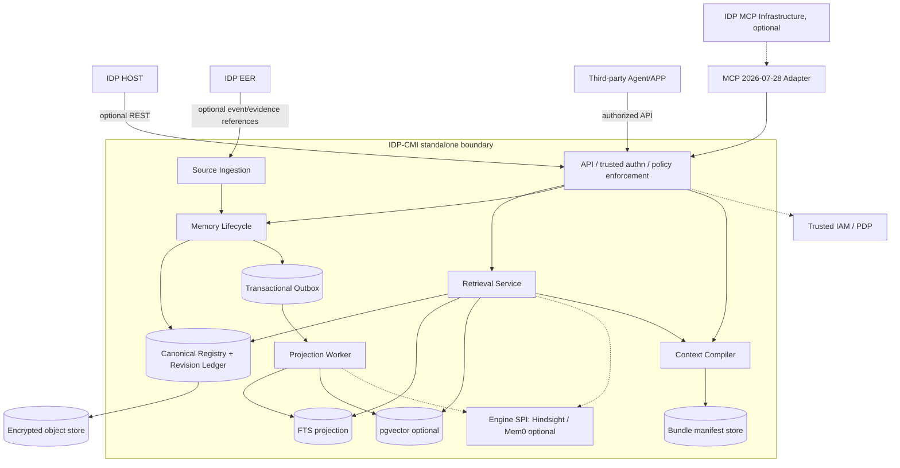
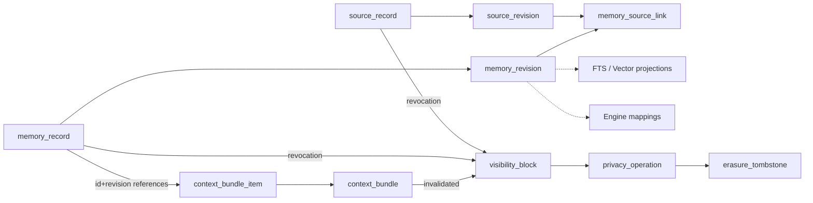
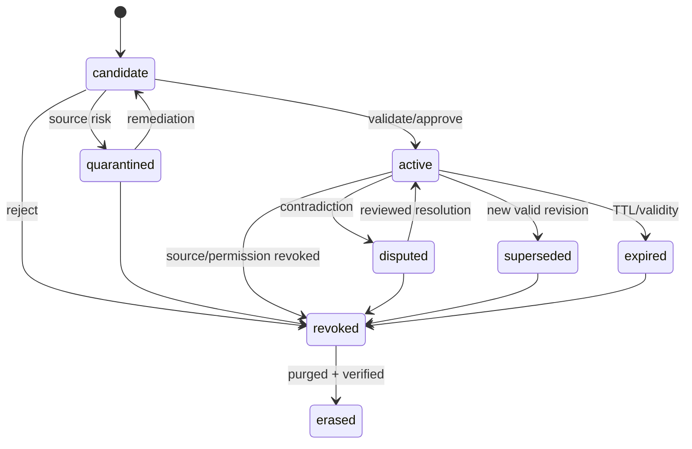

# IDP-CMI Technical Design V1.0

**IDP Context & Memory Infrastructure / 企业级上下文与记忆基础设施**  
编号：CMI-TD-001 · 日期：2026-10-15 · 状态：**Draft for Engineering / Security / DBA Review**  
上游基线：《IDP-CMI Core Specification V1.0》与《ADR-001 Build vs Adopt V1.0》；本文件不替代二者。  
交付属性：**数据库/接口/算法/事务的参考技术设计 + 可静态验证工件；不是已部署或经数据库真实执行的产品**。

## 0. 决策摘要

**目标**：在不安装 EER、HOST、Hindsight、Mem0 的情况下，CMI S0 基线可独立完成受控来源登记、候选/已批准记忆保存、FTS 检索、生命周期变更、ContextBundle 编译和撤权屏蔽；并可在后续通过 SPI 插入记忆算法引擎。

| 范围 | V1 基线决策 | 明确不承担的职责 |
|---|---|---|
| Authority | IDP-CMI Owns Source/Memory/Bundle/Erasure canonical metadata | 不取代 SoR、EER Execution State/Evidence、HOST AgentRun |
| Persistence | PostgreSQL 规范账本 + DB revision + transactional outbox | 不把向量/Graph/引擎 bank 当唯一数据源 |
| Retrieval | PostgreSQL FTS first; pgvector after embedding profile selected | 不依赖不透明引擎文字作为可信记忆 |
| Context Compiler | IDP 自有，预算、来源、时间、稳定排序、权限复验 | 不持有 HOST 的 system prompt 或模型推理责任 |
| IAM | 外部可信 IdP/PDP 接入，tenant RLS 防御层 | 不自己实现 OAuth 认证协议或以 RLS 代替 ABAC |
| External engines | Hindsight / Mem0 对照评估，插件仅操作派生数据 | 不让插件直接晋升 Active / 修改 canonical revision |
| MCP | 仅可选标准 Server Adapter，现代协议 2026-07-28 | 不依赖 IDP MCP Infrastructure；不开发旧版适配 |

### 0.1 非功能不变量

- **IND-T01** 无 HOST/EER/外部引擎启动依赖，API/worker 的核心健康检查不访问它们。
- **IND-T02** 当前权限始终优先于任何缓存、历史 Bundle 与派生索引；ACL/PDP 无法判断即拒绝，不使用缓存成功作为替代。
- **IND-T03** PostgreSQL 规范写入 + 修订 + 事务 outbox 原子提交；索引及外部引擎只做可追踪、可重建的最终一致投影。
- **IND-T04** EER 的 Verifier/Evidence 和业务 SoR 状态不可从 MemoryRecord 推断代替。
- **IND-T05** 擦除的普通禁止读路径必须同步生效；物理删除逐域跟踪完成，不假装备份立即被同步删除。
- **IND-T06** 数据权威、来源类型与模型 confidence 三者不混淆。

## 1. 部署拓扑与领域模块



**推荐实际进程**：`cmi-api`（模块化后端）、`cmi-worker`（投影/清理）、`postgres`、`object-store`；选定 Embedding 模型后才安装 pgvector 并开启向量投影；外部 engine 独立运行。缓存仅在有可测收益时引入。`live` 不探测外部系统，`ready` 只检查当前启用的核心依赖（DB 与策略访问能力）；外部引擎断开时给出 degraded，而非强制整个 S0 不可用。

**模块目录**：`domain/source`, `domain/memory`, `domain/context`, `policy`, `storage/postgres`, `projections`, `engines/spi`, `adapters/{host,eer,mcp}`, `ops`, `tests`。模块不等于微服务数量。

## 2. 核心数据模型与物理落地

### 2.1 数据对象对照表

| 逻辑契约 | PostgreSQL 实体 | 关键数据库不变量 | 安全要求 |
|---|---|---|---|
| SourceRecord | `source_record`, `source_revision` | `(tenant,system,key)` 稳定唯一；版本只追加；原始 URI/哈希按版本固定 | Source trust 不等于事实权威；对象存储另鉴权 |
| MemoryRecord | `memory_record`, `memory_revision` | 同租户 ID、CAS current_revision、追加 revision、claim 单位可追溯 | 非 active 默认不可见；模型提取只可 candidate |
| Source→Memory | `memory_source_link` | 固定 `(source_id,source_revision)`；联合 tenant FK | 读时再核来源撤权与权限 |
| Visibility | `visibility_block` | `tenant+resource_kind+id` 同步屏蔽 | 任何 FTS/ANN/引擎召回都要二次判定 |
| ContextBundle | `context_bundle`, `context_bundle_item` | 固定 Manifest 哈希、模型与 tokenizer、TTL、预算约束 | 当前资源权限和来源版本复核；Bundle 失效联动 |
| Erasure | `privacy_operation`, `erasure_tombstone` | Phase A block → Phase B purge → Phase C verify | Tombstone 不存 claim/URI/哈希/可还原正文 |
| Delivery | `outbox_event`, `projection_receipt` | 与领域状态原子写；投影多次重放幂等 | 事件只携最小引用，不能推送敏感 claim |
| Plugin | `engine_mapping` | engine/generation/规范 ID 映射 | 外部 engine 无权跨租户查询或晋升事实 |
| Audit | `audit_event_ref` | 只存外部审计证据引用 | 不向日志写敏感正文 |
| Idempotency | `idempotency_record` | `(tenant,principal,operation,key)` 唯一 | 同键异参数 409；结果正文不裸存 |

**已生成**：`sql/001_canonical.sql`, `sql/002_rls.sql`, `sql/003_projections_optional.sql`。SQL 是供 DBA 审核的设计迁移草案，尚未在 PostgreSQL 上实际执行。若采用 Flyway/Alembic，应按生产版本重新整理迁移 ID、权限和回滚策略。

### 2.2 关系及擦除边界



**关键设计细节**：`context_bundle_item` 有意使用软引用，不能让强 FK 阻止对 Memory/Source 明文的合法擦除；物理擦除时仍必须删掉敏感派生 Manifest/blob，并使旧 Bundle 不可对外消费。`erasure_tombstone` 的 ID 本身仍是受保护的个人信息关联风险，须单独保留期限、最小权限及合法依据。

### 2.3 数据不可变与历史记录

正常修订使用 Append Revision；`memory_record.current_revision` 与当前 status 使用 CAS 更新，不默默覆盖旧 claim。合法擦除是追加不可变原则的受控例外：完成净化时旧明文历史也需要删除/加密销毁；审计仅保留法定允许的最小证据。数据库级 Trigger/GRANT 可以阻断普通业务修改修订行，**但必须预留有专门授权的 erasure worker 路径**。

### 2.4 双时态语义与限制

- 业务时态 `valid_from`, `valid_to` 指事实被认为适用的业务区间 `[from,to)`；`recorded_at` 是 CMI 保存信息的系统时点；二者不得交换。
- 查询 `as_of_valid=T1, known_at=T2` 时，以 **T2 前系统已登记的修订** 在 T1 是否有效来评价，而不是拿现在最新事实伪造当时认知。
- `recorded_at` 是数据库记录时间而不是严格的跨事务 commit 全序；`outbox_event_id` 也不是全局严格单调的提交顺序。V1 提供实体级时间点查询与不可变修订，**不承诺依靠这些字段实现精确全局历史快照**。如客户要求严格历史快照复现，应增设一致的快照机制和数据库恢复/LSN 保留策略，经事务审查后升级。
- 如果过去修订被法律要求擦除，不可以为了“历史可复现”重新暴露它；只返回历史不可用及可审计原因。

## 3. 租户和资源授权（不可省略）

### 3.1 三道防线

1. **API 认证边界**：校验凭据有效期、issuer、audience、tenant 授权映射、委派链。外部 JSON 中的 `tenant_id/principal/source_trust/active/approved_policy_reference` 一律不能作为可信来源。
2. **PDP 资源判断**：动作、purpose、subject、scope、classification、policy_version、时间与 source 权限。检索前构建允许范围，并在返还前再次校验；故障 fail closed。
3. **PostgreSQL tenant RLS**：DB 事务里受信服务执行 `SET LOCAL cmi.tenant_id`，联合 tenant 主键/FK 防越界；启用 `FORCE ROW LEVEL SECURITY`。普通池账号非 owner、非 `BYPASSRLS`，不能让其他用户直连 DB。

**已知限制**：PostgreSQL 自定义配置变量不是防伪 token。假设不可信输入可以执行任意 SQL，攻击者可能改写该 GUC。RLS 是可信 API 边界后的二次隔离，不是单独的可信身份管理。对强隔离客户可部署独立 DB/cluster + 独立 service role。DB 角色创建、表属主、权限授予与连接池策略必须由 DBA/IAM 共同会签。

### 3.2 检索必须执行的断言

`tenant verified` ∧ `purpose allowed` ∧ `policy active` ∧ `resource scope allowed` ∧ `memory.status=active` ∧ `no visibility block` ∧ `all required sources accessible` ∧ `temporal filter` ∧ `classification permitted`。

- 无法判断 = Deny；**向量相似度不是授权机制**。
- 缓存键需要租户、主体、purpose、策略版本、资源版本，缓存命中还需当前权限复验。
- Bundle 在 HOST 使用前可调用 `/contexts/{id}/validate`；撤权发生在编译后也不应继续使用旧文本。
- 未经批准的 embedding/LLM 供应商不得接收企业敏感文本；前置处理数据驻留和目的许可。

### 3.3 威胁与防御矩阵

| 威胁 | 触发点 | 安全控制与测试 |
|---|---|---|
| 跨租户泄露 | RLS/engine bank/混合检索 | 每表 tenant composite key、PDP 二次判定、跨租户负例 |
| 提示注入升级为指令 | 来源网页/日志/历史对话 | 所有检索片段标记为不可信数据、保留引用、不得提升为 system 指令 |
| 撤权后旧索引回流 | ANN/缓存/引擎重放 | Registry barrier 先写，检索后复核，旧 outbox 不能重活化 |
| 源删除后派生残留 | Memory/Bundle/graph/备份 | 来源依赖图，擦除作业多域 ACK + 复验，恢复前重放屏蔽 |
| confused deputy | 代理替用户查询 | 验证 actor、delegator、aud 与 purpose；不接受工具自报身份 |
| 结果伪造/过度自信 | LLM extraction/reflect | `candidate` only、source refs、approval gates、conflict/quarantine |

## 4. 生命周期与并发事务设计

### 4.1 记忆状态机



> 图中的 `erased` 是业务状态终点，**物理上仅允许返回最小 ErasureTombstone，不再返回带正文的 MemoryRecord**。实际 PostgreSQL `memory_record.status` 不使用 `erased` 枚举：终态通过删除主体 + tombstone 表表达。

### 4.2 关键事务原则

- 记忆状态变更必须提交 `expected_revision`，`SELECT ... FOR UPDATE` 对同一聚合串行化；未匹配返回 `412`；重试只可使用当前 revision 并重新校验策略。
- 同一次 DB 事务追加 Revision + 修改 Registry 状态 + Visibility Barrier（必要时）+ Outbox + 审计引用 + 幂等记录。先发 event 后提交 canonical 是禁止的。
- 来源撤权必须以同步屏蔽开头，并在读取/新候选激活时检查来源状态；大扇出应建立源级统一 barrier，不能在后台逐条处理期间泄露。
- 由于 `SKIP LOCKED` 读取的队列视图不是全量一致视图，只用于 outbox worker，不用于业务历史查询。
- 投影重新处理旧事件时以 `memory_id/revision/generation` 校验，旧 revision 绝不能覆盖当前 state/撤权。

**参考算法和 SQL 事务顺序见 `sql/transaction_recipes.md`**。

### 4.3 幂等、提交顺序与投影票据

- 客户端写入使用 `Idempotency-Key`；键空间为 `(tenant,principal,operation,key)`；原请求 hash 相同返回保存的结果，hash 不同返回 `409 IDEMPOTENCY_CONFLICT`。
- `projection_watermark` 在 V1 定义为 **opaque per-write ticket + generation**，不假装通过 sequence/UUIDv7 推导全局已提交顺序。响应可通过 `projection_receipt(event_id,generation,projection_name)` 判断本次写是否已投影。
- `min_projection_watermark` 要求的是“我的指定写入已被所需投影处理”，如果未处理，服务可短等待，否则返回 `409 PROJECTION_LAG`；不能假装无搜索结果。
- Vector/Graph/Hindsight/Mem0 不是事务参与者：**无分布式强一致承诺**；只保障 canonical 原子提交、投影幂等以及可见性同步过滤。

## 5. Context Compiler 内部设计

### 5.1 输入/输出及责任

输入：可信内部 AuthContext（通过网关/PDP），明确 task intent、`model_id/tokenizer_id/tokenizer_version`、`hard_limit_tokens`、`reserved_output_tokens`、`reserved_system_tokens`、purpose、时间窗口、要求的投影 ticket。客户端的 budget 建议必须经服务端 policy clamp。

输出：按重要度排序的 `ContextBundle`、含 `memory_id/revision/source_refs` 的 Manifest、模型与编译器版本、有效期限、投影状态、预算与 omitted reason。编译不触发外部业务写操作。

### 5.2 Pipeline (12 steps)

1. Authenticate / Authorize context compilation.
2. Resolve model + tokenizer profile; clamp maximum prompt/context budget.
3. Resolve current policy version and data residence requirements.
4. Construct resource/scope prefilter from trusted PDP / subject permissions.
5. Search canonical FTS and approved vector/engine projections; use fixed query and candidate caps.
6. Map all candidates back to canonical `(tenant,memory_id,revision,source_refs)`; un-mappable result is not an Active memory.
7. Filter by valid time, known-at, status, source revocation, ACL, classification; deny on policy outage.
8. Score remaining candidates (relevance, domain-authority fit, temporal fit, optional diversity); not as replacement for hard gates.
9. Deduplicate and group contradictory claims; either include conflict labels or exclude disputed data; never silently merge contradictory facts.
10. Reserve output/system/provenance budget; select mandatory context first; stable pack optional context without truncating figures/units/negations.
11. Re-evaluate current authorization for the selected exact revisions and source refs; on change fail/recompute; sign/store Manifest hash and TTL.
12. Return Bundle; HOST must revalidate on later use; EER/SoR must still check current business facts before executing.

**Stable score suggestion (not validated learned model)**: `score = relevance * authority_fit * temporal_fit + diversity_bonus - staleness_penalty`; all components bounded, weights calibrated on held-out Parcel tasks. *Authorization never appears as a soft factor.*

### 5.3 Packing, Tokenizer, security

- `available = hard_limit - reserved_output - reserved_system - fixed_overhead`; if mandatory source/role disclaimers exceed available → `422 INSUFFICIENT_CONTEXT_BUDGET` rather than silently omit.
- Count source/reference markup cost, not just claim body. Use exact tokenizer when installed; estimate must report `exact_count=false` and hold safety margin.
- Summarization is a separate *untrusted-derived transformation* subject to origin refs and temporal labels, not an implicit text-shortening function. Summaries require tests for numbers, units, negatives and time validity.
- Bundle replay levels：manifest replay (V1), byte replay (conditional lawful retention), semantic replay (best-effort). Hash of Manifest doesn't prove HOST actually sent the exact text to an LLM.

**实现参考** `algorithms/context_compiler_reference.py` 是确定性 packing 的可运行示例，附 `tests/test_compiler_reference.py`。它不调用 PDP，**明确不是生产级授权/检索实现**。

## 6. API 详细设计

基于 Core Specification 的 OpenAPI 3.1 契约，提供 `api/cmi.openapi.yaml`（自带 request allowlist + canonical schemas）。接口资源命名保持不变；`api/contract_delta.md` 描述以下实现层含义。

| 端点 | 责任 | 成功 | 特别规则 |
|---|---|---|---|
| POST `/cmi/v1/sources/ingest` | 来源幂等创建/修订 | 201/202 | 受信来源/租户由服务端决定；同自然键不同 digest 409 |
| POST `/cmi/v1/memories/propose` | 生成 candidate | 201 | 不能由 Agent 自行声明 active / authoritative |
| POST `/cmi/v1/memories/search` | 授权检索 | 200 | 返回 current refs + sources + temporal mode + projection ticket |
| GET `/cmi/v1/memories/{id}` | 指定版本可见性校验 | 200 | 禁止返回 revoked/erased，非授权可隐藏资源存在性 |
| POST `/cmi/v1/memories/{id}/transitions` | CAS state transition | 200 | expected_revision 不匹配 412，同键异参数 409 |
| POST `/cmi/v1/contexts/compile` | Context bundle | 201 | 硬预算、policy/version、SourceManifest |
| POST `/cmi/v1/contexts/{id}/validate` | 上下文消费前复验 | 200 valid/invalid | policy / source / memory state / TTL changed → invalid |
| POST `/cmi/v1/privacy/erasure-requests` | 两阶段擦除 | 202 | 接受 ≠ 擦除完成；要求 operation tracking |
| GET `/cmi/v1/operations/{id}` | 查询作业 | 200 | verified/exception/retry 状态 |
| GET `/cmi/v1/health/{live,ready}` | 运维健康 | 200/503 | 不访问 HOST/EER/MCP/引擎作为必需条件 |

- HTTP 成功码只表达 CMI 接口本身，不代表 EER/Parcel 的业务目标达成。
- `409 PROJECTION_LAG` 按 Core Spec 继续兼容；`412 REVISION_PRECONDITION_FAILED` 是并发冲突，客户端先 read/current revision 再重新提交，不能后台自动覆盖。
- 失败规范：`{error:{code,message,request_id,retryable,details}}`；所有 403/404 信息防资源枚举；`X-Request-Id`, traceparent；对数据访问日志只写指针和策略决策 ID。
- MIME / schema 以 `api/cmi.openapi.yaml` 为准；**文档描述多于 OpenAPI 的实现约束须由后续 PR 拆成测试**。

### 6.1 Memory Engine SPI V1

```text
capabilities() -> versions, ID mapping, deletion granularity, rebuild, index filtering
extract(source_ref, secure_content_ref, profile) -> candidates[] + source spans
index(canonical_records, generation, idempotency_key) -> engine_ack
search(query, permitted_scope, filters, top_k) -> (memory_id,revision,engine_score)[]
delete(memory_refs_or_scope, operation_id) -> signed/verifiable completion ack
rebuild(canonical_snapshot_ref, target_generation) -> staged_generation
health() -> readiness and capabilities
reflect(...) -> unapproved candidates ONLY (OPTIONAL)
```

**生产资格的硬条件**：每条召回结果能映射规范 ID/source/version；有确定删除或安全重建能力；隔离可测；关闭引擎 S0 仍可运行；数据流与模型许可证核对完成。引擎自行 consolidation/reflect 产生的事实不允许直接写 active。

## 7. FTS / pgvector / Graphiti 的阶段化索引

- **S0**：先用 PostgreSQL `to_tsvector('simple')` + GIN 实现英文词法检索。简体中文没有天然完整分词，需要额外分词或 n-gram 方案；不得将 simple FTS 当作中文高质量检索的证据。
- **S1 可选**：通过明确的 EmbeddingModelProfile 登记 `(model_id,dimension,normalization,version,residency)`；投影建 generation，禁在模型变更时覆盖旧 embedding。ANN 索引按维度/租户规模和选择性决定。
- **pgvector 风险**：HNSW/IVFFlat 的过滤可能影响 recall，尤其多租户/高选择性 ACL；要和同数据的 exact recall@k 比较，并评估 tenant 分区 / exact prefilter / iterative scans。
- **Graphiti**：暂缓独立图谱投影。只有时序多跳测试证明其相对现有模型有质量/成本增益，才进入下一 ADR 评审。

## 8. HOST / EER / Parcel 接入

### HOST（可选）

HOST 请求 `/contexts/compile`，传 `task_ref`, model profile, budget；从返回的 Bundle/Manifest 中取可用上下文，作为数据引用装入 Agent prompt。HOST 管理自己的会话、用户交互、工具批准及模型推理；CMI 不要求 HOST 会话必须长期绑定一条 CMI 连接。HOST 消费旧 Bundle 时需要重新验证。

### EER（可选）

EER 在完成已验证业务执行后，向 CMI 提供**经授权、去敏、带来源的 Event/Evidence 引用**，CMI 作为经验候选处理；事件接收不意味着自动 approve。EER Actor/Execution/Verifier/Evidence 由 EER 持有；CMI outage 时不导致执行责任转移或创建绕路业务写接口。实际 Event/Evidence payload schema **仍待 EER 代码联调提供**，本文不虚构其真实字段。

### Parcel（第一条业务试点）

测试“创建面单失败—检索相似历史异常—核对当前 Parcel/渠道规则—建议处理—交由 EER 或获准原生业务服务执行—获得验证结果—新案例入 candidate”链路。以运行前业务权威快照和完成后的可验证结果评估质量，不以“模型回复通顺”代替完成。

## 9. 工程验收 Gate 与负例

| Gate | 必须证明 | 负例 / 方法 |
|---|---|---|
| TD-G0 | 无 HOST/EER/MCP/记忆引擎依赖可启动 | 停掉所有外部进程后 S0 API + health 正常 |
| TD-G1 | 租户/RLS/ABAC | 同 ID 跨租户、跨 purpose、伪造 tenant header、连接池复用均拒绝 |
| TD-G2 | 规范修订/CAS/idempotency | 双并发只有一个成功；412 不覆盖；同幂等键异 body 409 |
| TD-G3 | 来源撤权同步屏蔽 | Source revoke 时旧 ANN、旧 Bundle、并发写、缓存均不返明文 |
| TD-G4 | 投影一致/可重建 | worker crash、乱序 outbox、generation 切换、ticket lag 返回可解释 |
| TD-G5 | Context 正确性 | token 预算、来源、时间、冲突、必需段落均稳定；不可伪造获批事实 |
| TD-G6 | 擦除全域闭环 | registry/object/vector/engine/cache/bundle/备份恢复屏蔽均有完成证据 |
| TD-G7 | Parcel 端到端 | 不以 CMI 推断实时状态，不把建议当执行成功；回溯完整 |

**建议测试规模**：先从 40 项已有合同级负例开始，再按 ADR 方案扩为 240 个经审核样本；这些是 *计划样本数*，并非已实际完成。PoC 需要 S0 / S1(Hindsight) / S2(Mem0) 同场对照。安全 Gate 一票否决；质量指标另按评分卡汇总，不以综合分覆盖安全失败。

## 10. PR 顺序、依赖与交付证据

| PR | 预计成果 | 合入条件 |
|---|---|---|
| PR-01 | 项目骨架 + OpenAPI、error & authn middleware | 无外部引擎启动、请求拒绝默认安全 |
| PR-02 | 001/002 DDL + 租户角色/RLS + migration harness | 真正 PostgreSQL DB 集成测试、RLS 负例 |
| PR-03 | Source/Memory canonical + CAS/revisions + idempotency | 多并发、来源约束、同键重复负例 |
| PR-04 | revoke barrier + outbox + worker/receipt | 断电重启、乱序、撤权后 0 返回 |
| PR-05 | FTS + Context Compiler + Bundle/manifest | 中文检索限制标识、budget & replay 单测 |
| PR-06 | 擦除事务与物理净化调度 | 删除覆盖矩阵、恢复重放测试 |
| PR-07 | pgvector profile 与受权召回（可选） | exact recall 对照、tenant ACL 过滤 |
| PR-08 | Hindsight / Mem0 SPI PoC（非基线依赖） | 通过 ADR A1–A6 Gate 后才可进入生产链 |
| PR-09 | HOST、EER、Parcel adapters | 三系统分别独立启动，Parcel 完整证据闭环 |

**研发里程碑不是承诺排期**。企业 IdP/PDP、EER 当前 schema、HOST model profile、真实客户数据授权、KMS/驻留、备份策略、数据库性能规模尚需项目方提供。

## 11. 上线前必须作出的开放决策

| 决策 | 建议默认 | 决策者 / 触发条件 |
|---|---|---|
| PostgreSQL 版本、HA/PITR、RLS 角色 | PostgreSQL >=16；独立 owner / pool role | DBA 安全审核，运行目标环境决定 |
| DB 强隔离租户 | 共库 tenant + RLS 作为 S0；受规制客户独立 DB | 合同数据驻留/威胁等级 |
| IAM/PDP | 复用客户 IdP 和统一 PDP | 实际凭据、代理委派范围确认 |
| Embedding 模型和维度 | S0 不绑定；评测后锁版本 | 中英文 Recall、延迟、成本实测 |
| 对象存储、KMS、Redis/Valkey | 由部署地区和许可证选择 | 采购/运维/法务会签 |
| 原始数据的保留期限 | 按客户数据治理政策，不预设永久 | Data Owner + Legal |
| P95、TPS、RPO、RTO | 暂无数值承诺，先测定基线 | SLO 与客户生产合同 |
| 长期反思/Graphiti/跨区多活 | V1 暂缓 | PoC 显示显著业务增益后另立 ADR |

## 12. 版本、核验状态及后续批准

### 12.1 本次已经实际完成

- 已编制带 tenant composite PK/FK 的 canonical DDL 草案、RLS 策略草案、可选投影 DDL。
- 已编制与 Core Spec 同路径的 OpenAPI 契约快照以及新增工程接口差异说明。
- 已编制确定性 packing 的 Python 参考实现与 unit tests；其 PDP 与数据库集成未实现。
- 已编制事务 recipe、威胁/验收矩阵、工程 PR 计划和离线 HTML 阅读版。

### 12.2 明确没有完成的事项

- 未实际执行 PostgreSQL migration 或真实并发/RLS 数据库集成测试。
- 未测量真实 P95/QPS、中文检索质量、Hindsight/Mem0/Graphiti 的业务效果。
- 未核对 IDP HOST / EER 当前部署的实际 API 源码，也未部署任何 production service。
- 未完成法律合规、客户 IAM、备份灾备及安全渗透测试会签。

### 12.3 外部规范与一手参考资料

1. [PostgreSQL 18 Row Security Policies](https://www.postgresql.org/docs/current/ddl-rowsecurity.html) — RLS 默认拒绝、owner/BYPASSRLS 例外、FORCE。
2. [PostgreSQL SELECT — SKIP LOCKED](https://www.postgresql.org/docs/current/sql-select.html) — 仅适于队列消费者，不适用于一般一致检索。
3. [PostgreSQL Transaction Isolation](https://www.postgresql.org/docs/current/transaction-iso.html) — CAS/锁/序列化重试。
4. [pgvector 官方 README](https://github.com/pgvector/pgvector) — ANN、过滤、iterative scanning、租户索引。
5. [MCP 2026-07-28 Official Specification](https://modelcontextprotocol.io/specification/2026-07-28) — stateless 协议与授权。
6. [OpenAPI 3.1.1 Specification](https://spec.openapis.org/oas/v3.1.1.html) — HTTP 契约描述。
7. [Hindsight Repository](https://github.com/vectorize-io/hindsight)、[Mem0 Repository](https://github.com/mem0ai/mem0)、[Graphiti Repository](https://github.com/getzep/graphiti) — 可插拔候选，本文不声称其通过 IDP PoC。

---

**推荐工程会签顺序**：架构负责人确认责任域 → DBA 验证 PostgreSQL DDL/RLS/迁移 → 安全负责人确认身份/数据流/撤权/擦除 → 开源许可证与数据驻留审核 → 项目负责人批准 S0/引擎 PoC 开发。未通过安全和数据库 Gate 的设计不可宣称 production ready。
